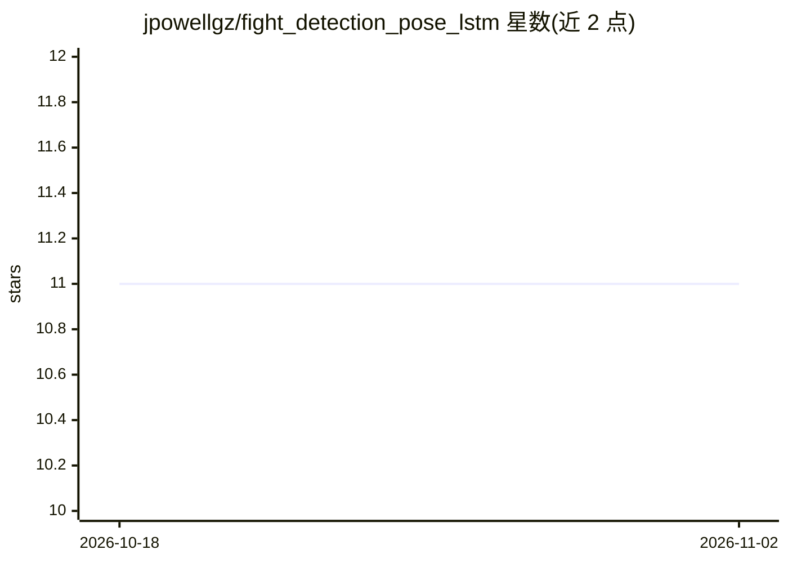

# jpowellgz/fight_detection_pose_lstm

⭐ 11 · Python · 推送 2026-10-20 · [GitHub](https://github.com/jpowellgz/fight_detection_pose_lstm) · 个人维护

**基于姿态估计与 Bi-LSTM 的视频打斗检测研究与训练代码**

论文配套代码：用 OpenPose 估计人体关键点，计算肢体角度向量（默认 20 角度箱×13 肢体=260 维），输入 Bi-LSTM 分类视频是否含打斗。提供抽帧、训练脚本与 JSON 配置，可用 model_base.py 继承替换关键点或分类模型；在 Movie Fight、Surveillance Camera、Violence Detection 三个数据集验证（论文报告准确率 95%/67%/81%）。仅测试过 CPU，需自备 OpenPose COCO 模型文件，安装用 Astral uv。

## 筛选速览

| 维度 | 判定 | 备注 |
|---|---|---|
| AI 角色 | `ai-native` | 本体是模型或模型工具 |
| 许可风险 | `none` | — |
| 部署形态 | `None` |  |
| 模型依赖 | — | README 未给出锁定关系 |
| 硬件要求 | — | 无带数字的原话,不猜 |
| 安装摩擦 | `low` | 无编译、无系统依赖或容器化 |
| 成熟度 | — | 结构信号不足 |

## 能力要点

- OpenPose 姿态估计→肢体角度向量→Bi-LSTM 分类的完整流水线
- 可继承 model_base.py 替换关键点或分类模型
- 提供抽帧与训练脚本及 JSON 配置
- 在三个公开打斗检测数据集上验证

## 适用场景

- 复现论文的打斗视频分类方法
- 在自己的打斗/暴力视频数据集上训练分类模型
- 替换关键点模型或分类模型做对比实验

## 场景标签

 · 领域:计算机视觉/行为识别

## 证据(README 行号)

> L10: classification of videos containing fights. The method is based in the combination of a deep neural
> L11: network for human detection known as Open Pose, and the recurrent neural network known as Long

## 星数曲线

2026-10-18 11 → 2026-11-02 11（+0）

---
*卡片 v1 · prompt 1.4 · 生成 2026-11-02 · 置信度 high · 依据 README sha `83df6ba656fa` · [字段定义](../../DATASET.md)*
