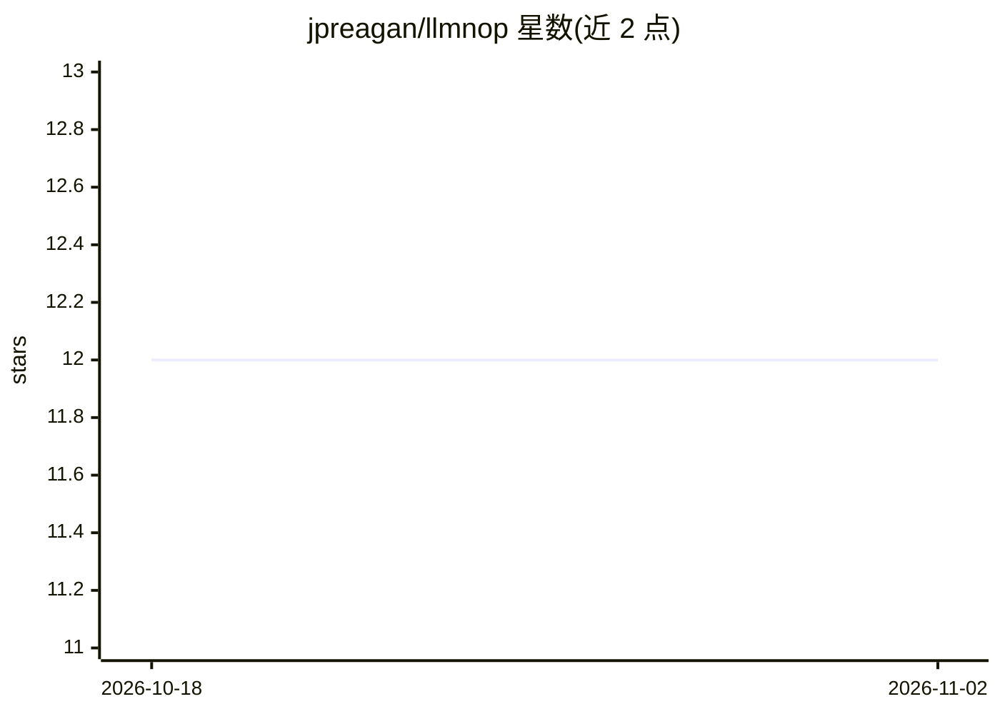

# jpreagan/llmnop

⭐ 12 · Rust · Apache-2.0 · 推送 2026-09-26 · [GitHub](https://github.com/jpreagan/llmnop) · 个人维护

**LLM 推理端点性能基准测试 CLI 工具**

命令行工具，通过 API 向 LLM 推理端点发送流式请求，测量不同并发下的 TTFT/TTFO、请求延迟、每请求吞吐、整体吞吐及失败率等指标。支持 chat/responses/messages 三种 API 路径与 Bearer/x-api-key 认证，可配置输入输出 token 数、并发与超时。提示词为莎士比亚文本采样的合成负载，不评估回答质量。结果保存为 summary.json 与 requests.jsonl，通过 Homebrew 或安装脚本安装。

## 筛选速览

| 维度 | 判定 | 备注 |
|---|---|---|
| AI 角色 | `ai-ecosystem` | LLM/agent 周边工具 |
| 许可风险 | `permissive` | Apache-2.0 |
| 部署形态 | `None` |  |
| 模型依赖 | — | README 未给出锁定关系 |
| 硬件要求 | — | 无带数字的原话,不猜 |
| 安装摩擦 | `low` | 无编译、无系统依赖或容器化 |
| 成熟度 | — | 结构信号不足 |

## 能力要点

- 测量 TTFT/TTFO/延迟/吞吐/分位数/失败率等指标
- 支持 chat/responses/messages 三种 API 路径与可选认证
- 可调输入输出 token 目标、并发、请求数与预热
- 结果保存为 summary.json 与 requests.jsonl

## 适用场景

- 对比不同模型、服务商或服务配置的性能
- 观察并发升高时端点性能变化
- 对本地推理服务做负载测试并留存结果

## 场景标签

`模型评测` · 领域:评测与运维

## 证据(README 行号)

> L3: `llmnop` benchmarks the performance of LLM inference endpoints. It answers the question:
> L7: Use it to compare models, providers, and serving configurations, or see how performance changes as more requests sha

## 星数曲线

2026-10-18 12 → 2026-11-02 12（+0）

---
*卡片 v1 · prompt 1.4 · 生成 2026-11-01 · 置信度 high · 依据 README sha `5a11fbb60e14` · [字段定义](../../DATASET.md)*
