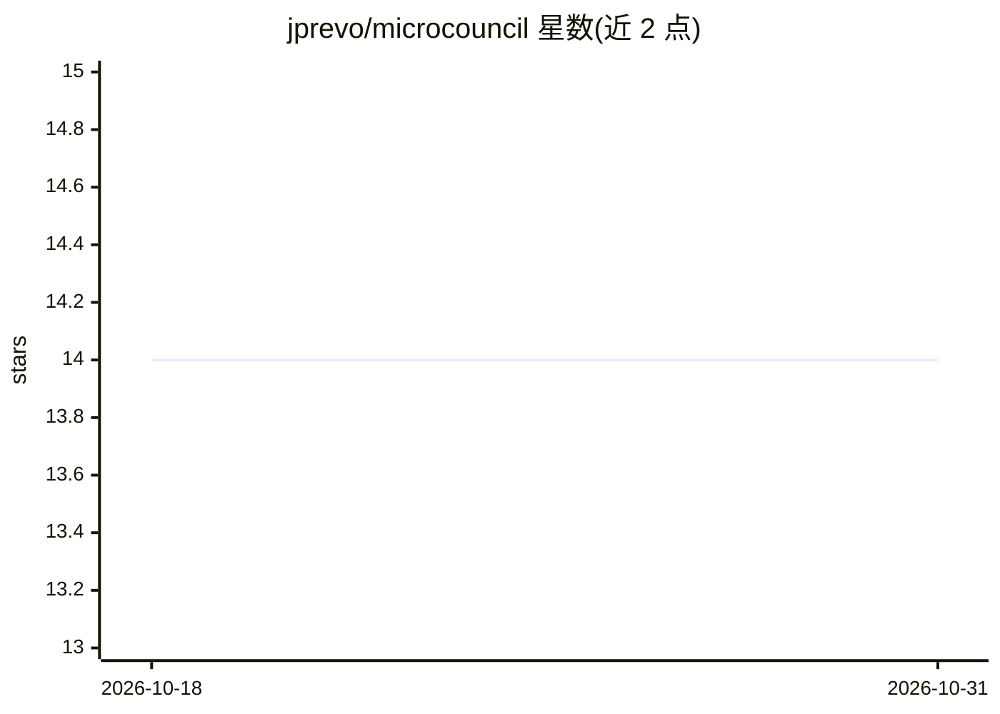

# jprevo/microcouncil

⭐ 14 · TypeScript · MIT · 推送 2026-10-03 · [GitHub](https://github.com/jprevo/microcouncil) · [官网](https://microcouncil.me) · 个人维护

**生成“专家委员会”讨论提示词的浏览器网页应用**

纯浏览器运行的网页应用：用户选择委员会成员、群体动态与可选指令，生成一段提示词，复制到 ChatGPT、Claude、Gemini 等助手后由助手扮演多位专家讨论指定话题。数据本地存储，无需账号或 API key。另附 agent skill（Python 3.9+、无额外依赖），可让 agent 创建、保存并运行委员会，支持复制 skill/ 目录或经 Hermes 安装。本地运行使用 Node.js 24 与 npm。

## 筛选速览

| 维度 | 判定 | 备注 |
|---|---|---|
| AI 角色 | `ai-ecosystem` | LLM/agent 周边工具 |
| 许可风险 | `permissive` | MIT |
| 部署形态 | `library` | 以包/库形式分发 |
| 模型依赖 | — | README 未给出锁定关系 |
| 硬件要求 | — | 无带数字的原话,不猜 |
| 安装摩擦 | `low` | 无编译、无系统依赖或容器化 |
| 成熟度 | — | 结构信号不足 |

## 能力要点

- 选择成员/群体动态/指令后生成委员会提示词
- 纯浏览器运行，数据本地存储，无需账号与 API key
- 支持保存委员会及导入导出数据
- 附 agent skill，让 agent 创建、保存并运行委员会

## 适用场景

- 想听多位专家视角讨论某个决策或话题
- 为头脑风暴/决策支持生成结构化提示词
- 把委员会技能装进自己的 agent 使用

## 场景标签

`提示工程` · 领域:Agent 开发

## 证据(README 行号)

> L5: Build a prompt for a council of experts who discuss a topic together in your
> L12: The web app runs entirely in your browser, stores data locally, and needs no
> L13: account or API key. It generates prompts; your chosen assistant runs the council.

## 星数曲线

2026-10-18 14 → 2026-10-31 14（+0）

---
*卡片 v1 · prompt 1.4 · 生成 2026-10-31 · 置信度 high · 依据 README sha `9d7c92e41000` · [字段定义](../../DATASET.md)*
