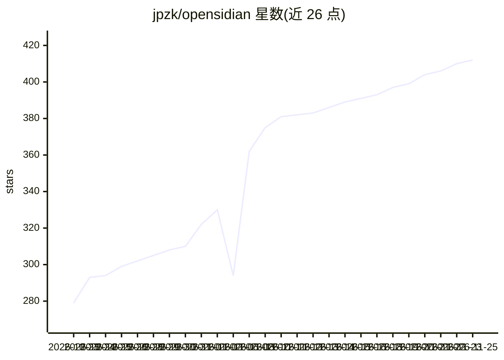

# jpzk/opensidian

⭐ 412 · JavaScript · GPL-3.0 · 推送 2026-11-24 · [GitHub](https://github.com/jpzk/opensidian) · [官网](https://www.opensidian.org) · 个人维护

**开源跨平台 Markdown 笔记应用，兼容 Obsidian vault**

基于 Rust + Tauri v2 的 Markdown 个人知识管理工具，GPLv3 开源非营利，提供图谱、画布与社区插件机制，可直接打开 Obsidian vault。README 为 Linux 提供 AppImage/Flatpak/RPM/DEB/Nix 多种安装包，macOS 提供 dmg 与 zip（未签名，需手动放行），也可从源码编译。社区插件默认关闭（restricted mode），启用后插件运行任意代码，程序启动经原生对话框逐项授权；插件密钥经系统 keyring 存储。README 声明该项目主要由 AI 模型（Claude，经 Claude Code）编写代码与文档，非与 Obsidian 官方关联。

## 筛选速览

| 维度 | 判定 | 备注 |
|---|---|---|
| AI 角色 | `ai-enhanced` | 去掉 AI 部分产品仍成立 |
| 许可风险 | `viral` | GPL-3.0 |
| 部署形态 | `None` |  |
| 模型依赖 | — | README 未给出锁定关系 |
| 硬件要求 | — | 无带数字的原话,不猜 |
| 安装摩擦 | `medium` | 含编译或系统依赖之一 |
| 成熟度 | — | 结构信号不足 |

## 能力要点

- 兼容 Obsidian vault 与大部分 Obsidian 社区主题
- Linux 提供 AppImage/Flatpak/RPM/DEB/Nix 安装方式
- 社区插件默认 restricted mode，程序启动经对话框授权并记录 sha256
- 下载文件提供 SHA256 校验、GPG 签名与 SLSA 构建 attestation

## 适用场景

- 在 Linux/macOS 上管理 Markdown 笔记与知识图谱
- 沿用现有 Obsidian vault 并使用社区主题
- 以受限权限模式运行社区插件并控制程序启动授权

## 场景标签

`知识库管理` `知识图谱` · 领域:知识与检索

## 证据(README 行号)

> L4: Open-source and non-profit under GPLv3, vault-compatible cross-platform markdown notes app. It's based on Rust + Tau
> L213: opensidian was built predominantly with AI models. Nearly all of the code, the design docs, and this README were w

## 星数曲线

2026-10-23 279 → 2026-11-25 412（+133）

---
*卡片 v1 · prompt 1.4 · 生成 2026-11-25 · 置信度 high · 依据 README sha `67c9ea9cb4ab` · [字段定义](../../DATASET.md)*
