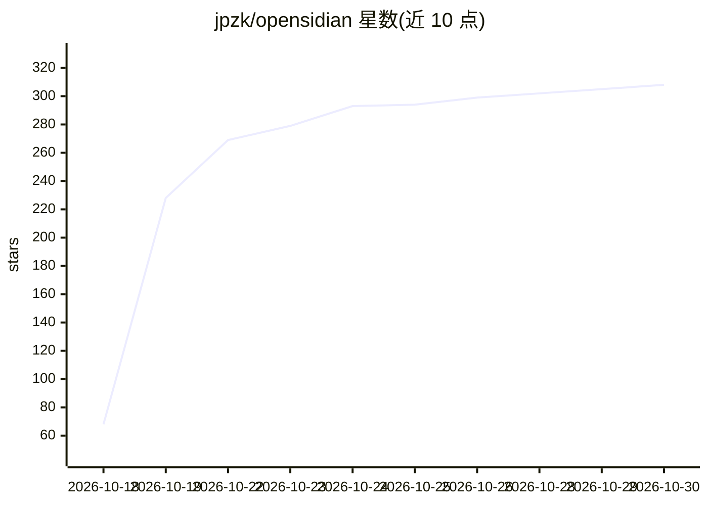

# jpzk/opensidian

⭐ 308 · JavaScript · GPL-3.0 · 推送 2026-10-29 · [GitHub](https://github.com/jpzk/opensidian) · [官网](https://www.opensidian.org) · 个人维护

**Rust+Tauri 的跨平台 Markdown 笔记应用，兼容 Obsidian vault**

GPLv3 许可的开源 Markdown 笔记应用，基于 Rust 与 Tauri v2，可直接打开现有 Obsidian vault。功能包括实时预览/源码/阅读模式、wikilink 与反向链接、标签与图谱视图、多标签与快速切换器、拖拽插入图片与 PDF 等。产品本身不含 AI 功能；README 披露其代码主要由 Claude 模型生成、由单一维护者审校。当前仅提供 Linux x86_64 安装包（AppImage/Flatpak/RPM/DEB），处于重度开发阶段，正在招募 Linux 发行版维护者。

## 筛选速览

| 维度 | 判定 | 备注 |
|---|---|---|
| AI 角色 | `ai-enhanced` | 去掉 AI 部分产品仍成立 |
| 许可风险 | `viral` | GPL-3.0 |
| 部署形态 | `None` |  |
| 模型依赖 | — | README 未给出锁定关系 |
| 硬件要求 | — | 无带数字的原话,不猜 |
| 安装摩擦 | `medium` | 含编译或系统依赖之一 |
| 成熟度 | `idea` | |

## 能力要点

- vault 兼容：直接打开现有 Obsidian vault，支持 wikilink、反向链接与图谱视图
- 5 种 Linux 安装格式（slim/portable AppImage、Flatpak、RPM、DEB），下载提供 GPG 签名校验
- 内置 4 套 Obsidian 社区主题并支持热加载自定义主题与 CSS 片段
- README 声明代码主要由 AI 模型（Claude）编写、由单一人类维护者审校

## 适用场景

- 用开源应用继续管理我的 Obsidian 笔记库
- 在 Linux 上获得带图谱视图与反向链接的本地 Markdown 笔记体验
- 对下载的安装包做 GPG 签名与 SHA256 校验后离线安装

## 场景标签

`知识库管理` · 领域:知识与检索

## 证据(README 行号)

> L87: opensidian was built predominantly with AI models. Nearly all of the code, the design docs, and this README were wr
> L4: Open-source and non-profit under GPLv3, vault-compatible cross-platform markdown notes app. It's based on Rust + Tau

## 星数曲线

2026-10-18 68 → 2026-10-30 308（+240）

---
*卡片 v1 · prompt 1.4 · 生成 2026-10-22 · 置信度 low · 依据 README sha `8de6c093fbe2` · [字段定义](../../DATASET.md)*
