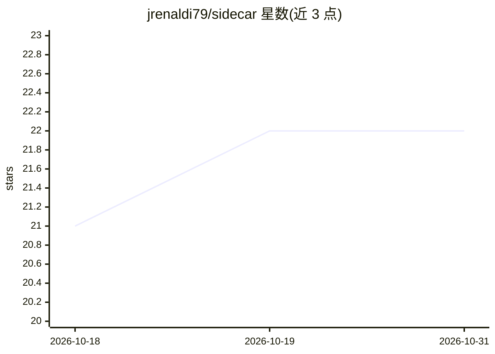

# jrenaldi79/sidecar

⭐ 22 · JavaScript · MIT · 推送 2026-04-06 · [GitHub](https://github.com/jrenaldi79/sidecar) · [官网](https://claudesidecar.ai) · 个人维护

**在 Claude Code 旁开启并行 AI 窗口，可切换任意模型并回折结果**

基于 Electron 的并行第二窗口工具：读取 Claude Code 或 Cowork 的当前会话上下文，传给 Gemini、GPT、DeepSeek、Qwen、Grok 等模型（经 OpenRouter 或直连 provider），主会话继续工作的同时与 sidecar 对话，完成后点击 FOLD 将结构化摘要回传主上下文。安装时自动注册 MCP server 与 Skill，支持交互与 headless 两种模式、三种 agent 权限模式、MCP 继承与会话持久化。以 npm 全局包形式安装，需 Node.js 18+。

## 筛选速览

| 维度 | 判定 | 备注 |
|---|---|---|
| AI 角色 | `ai-ecosystem` | LLM/agent 周边工具 |
| 许可风险 | `permissive` | MIT |
| 部署形态 | `library` | 以包/库形式分发 |
| 模型依赖 | locked-api |  |
| 硬件要求 | — | 无带数字的原话,不猜 |
| 安装摩擦 | `low` | 无编译、无系统依赖或容器化 |
| 成熟度 | `idea` | |

## 能力要点

- 自动提取 Claude Code 会话上下文传给 sidecar 模型
- FOLD 按钮生成结构化摘要回传主上下文
- 交互与 headless 自治两种模式，chat/plan/build 三种 agent 权限
- 安装时自动注册 MCP server 并继承父会话的 MCP 工具

## 适用场景

- 用另一个模型核查 Claude 提出的方案或论断
- 在不污染主上下文的前提下探索支线问题
- 主会话写代码的同时并行审查测试覆盖或起草文档

## 场景标签

`编码 Agent` · 领域:编码与开发

## 证据(README 行号)

> L114: 1. **Context sharing.** Sidecar reads your Claude Code session from `~/.claude/projects/[project]/[session].jsonl`
> L115: 2. **Window launch.** An Electron window opens alongside your editor with the sidecar UI (OpenCode-powered).
> L7: Sidecar opens a real UI alongside Claude Code or Cowork, pre-loaded with your conversation context, connected to Gem

## 星数曲线

2026-10-18 21 → 2026-10-31 22（+1）

---
*卡片 v1 · prompt 1.4 · 生成 2026-10-27 · 置信度 high · 依据 README sha `e35171e5711e` · [字段定义](../../DATASET.md)*
