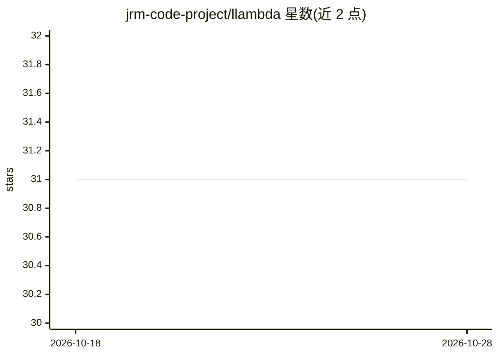

# jrm-code-project/llambda

⭐ 31 · Common Lisp · MIT · 推送 2026-08-09 · [GitHub](https://github.com/jrm-code-project/llambda) · 个人维护

**纯 Common Lisp 编写的 GGUF 量化 LLM CPU 推理引擎**

独立的 Common Lisp 推理引擎，直接读取 .gguf 文件中的 Q4_K_M/Q6_K 量化张量，在 SBCL 内原生解包 nibble、构建 transformer 并执行前向计算，不封装 llama.cpp 也不调用外部推理运行时。核心 GEMV 用 sb-simd 发出 AVX2/FMA 指令，经 lparallel 多线程并行。支持 Gemma4、Llama 3.1、Qwen2、Qwen3Next、Nemotron-H MoE 五种架构，提供 Top-K/Top-P 采样、可重入推理上下文与基于对偶数的 LoRA 前向求导。实验性可选后端经 C++ 桥接 ONNX Runtime 的 DirectML（GPU）与 VitisAI（NPU）。当前文件映射层要求 Windows，需 SBCL 与 AVX2 CPU。

## 筛选速览

| 维度 | 判定 | 备注 |
|---|---|---|
| AI 角色 | `ai-ecosystem` | LLM/agent 周边工具 |
| 许可风险 | `permissive` | MIT |
| 部署形态 | `desktop` | 安装包/桌面程序 |
| 模型依赖 | — | README 未给出锁定关系 |
| 硬件要求 | — | 无带数字的原话,不猜 |
| 安装摩擦 | `low` | 无编译、无系统依赖或容器化 |
| 成熟度 | `idea` | |

## 能力要点

- 原生解析 GGUF 并在 SBCL 内执行前向计算，不包装 llama.cpp
- AVX2/FMA 加速的 GEMV 与 lparallel 多线程并行
- 支持 Gemma4/Llama 3.1/Qwen2/Qwen3Next/Nemotron-H MoE 架构
- 对偶数实现的 LoRA 前向自动微分与可重入推理上下文

## 适用场景

- 在 Common Lisp 环境内直接运行 GGUF 量化模型
- 对选定投影层卸载到 DirectML GPU 或 Ryzen AI NPU 执行
- 在 REPL 中对模型做带梯度信息的 LoRA 实验与采样测试

## 场景标签

`推理引擎` · 领域:训练与推理

## 证据(README 行号)

> L6:  `llambda.lisp` is an independent Common Lisp inference engine for running
> L10:  The default CPU path does not wrap `llama.cpp` or call an external inference
> L13: SBCL. Experimental, opt-in accelerator paths use a small C++ bridge to ONNX

## 星数曲线

2026-10-18 31 → 2026-10-28 31（+0）

---
*卡片 v1 · prompt 1.4 · 生成 2026-10-26 · 置信度 high · 依据 README sha `f10baa167db6` · [字段定义](../../DATASET.md)*
