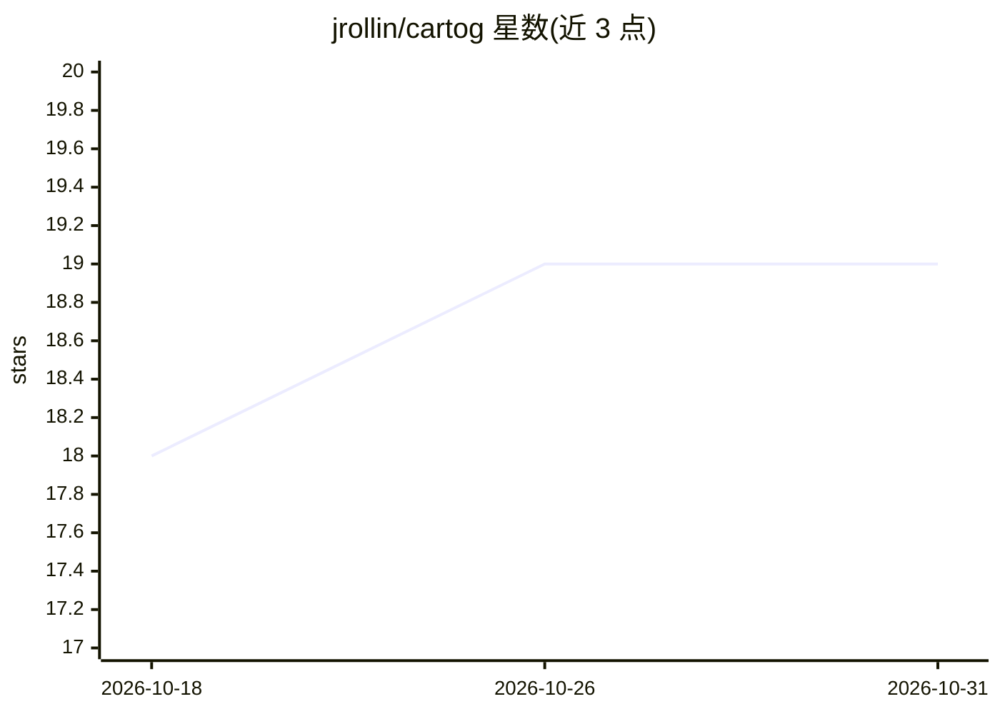

# jrollin/cartog

⭐ 19 · Rust · MIT · 推送 2026-10-26 · [GitHub](https://github.com/jrollin/cartog) · [官网](https://www.cartog.dev) · 个人维护

**本地代码知识图谱 CLI/MCP 服务器：图谱结构查询+RAG 语义检索**

用 tree-sitter 与可选 LSP 预计算代码图谱（符号及其调用/导入/继承关系），以单二进制+SQLite 存储，覆盖 18 种语言。提供 CLI 结构查询（search/refs/impact/outline）与 MCP 服务器（16 个工具），供 AI agent 查询代码而非灌入原始文件。可选 RAG 语义检索：FTS5+向量 KNN+cross-encoder 重排，本地 ONNX 运行或切换 Ollama/OpenAI 兼容端点，默认完全本地。安装方式含安装脚本、cargo 与预编译二进制。

## 筛选速览

| 维度 | 判定 | 备注 |
|---|---|---|
| AI 角色 | `ai-ecosystem` | LLM/agent 周边工具 |
| 许可风险 | `permissive` | MIT |
| 部署形态 | `library` | 以包/库形式分发 |
| 模型依赖 | local-ok | 支持本地模型 |
| 硬件要求 | — | 无带数字的原话,不猜 |
| 安装摩擦 | `low` | 无编译、无系统依赖或容器化 |
| 成熟度 | — | 结构信号不足 |

## 能力要点

- tree-sitter 预计算符号图谱，支持调用/导入/继承关系查询与传递性影响分析
- MCP 服务器提供 16 个工具，兼容 Claude Code/Cursor 等 MCP 客户端，输出默认压缩以节省 agent 上下文
- 可选三层混合 RAG（FTS5+向量+cross-encoder 重排），本地 ONNX 运行，无需 API key
- 单一静态二进制+SQLite，100% 本地，支持 18 种语言

## 适用场景

- 日常代码导航：查询谁调用了某符号、改动影响范围
- 为 AI 编程 agent 接入代码图谱，降低 token 消耗
- 对代码库做本地语义检索，按概念定位函数与类

## 场景标签

`知识图谱` `RAG` · 领域:知识与检索

## 证据(README 行号)

> L18: Use it from the CLI for day-to-day navigation, or as an MCP server so AI agents query the graph instead of flooding
> L120: cartog serve                     # 16 tools over stdio (+2 opt-in cross-project)

## 星数曲线

2026-10-18 18 → 2026-10-31 19（+1）

---
*卡片 v1 · prompt 1.4 · 生成 2026-10-28 · 置信度 mid · 依据 README sha `64110b91a79b` · [字段定义](../../DATASET.md)*
