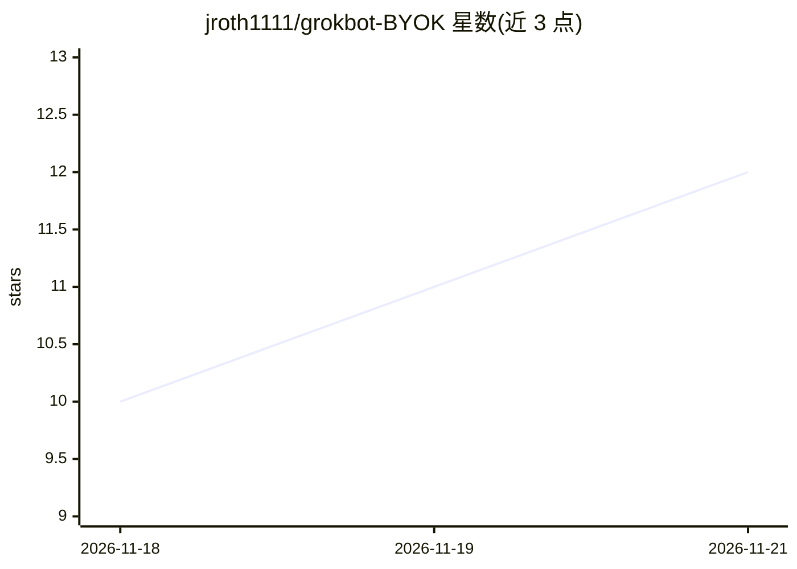

# jroth1111/grokbot-BYOK

⭐ 12 · TypeScript · 推送 2026-08-23 · [GitHub](https://github.com/jroth1111/grokbot-BYOK) · 个人维护

**本地推理代理：用自己的 LLM API 密钥接管 Grok Bot 的推理调用**

以本地代理（localhost:8788）形式拦截 Grok Bot 的 Connect-RPC 推理请求（chat、tab 补全、agent 模式），翻译为 OpenAI 兼容的 chat completion 格式并路由到用户自选的 provider。机制包括按优先级/延迟/轮询路由、自动故障转移、断路器、多 key 轮换与流空闲/TTFB 超时。安装方式为 git clone 源码加 npm run setup，补丁 Grok Bot 的 host-main.cjs 并由后台 watcher 在其更新后自动重新打补丁，npm run uninstall 可还原备份。需 Node.js 18+。

## 筛选速览

| 维度 | 判定 | 备注 |
|---|---|---|
| AI 角色 | `ai-ecosystem` | LLM/agent 周边工具 |
| 许可风险 | `permissive` | — |
| 部署形态 | `None` |  |
| 模型依赖 | locked-api |  |
| 硬件要求 | — | 无带数字的原话,不猜 |
| 安装摩擦 | `low` | 无编译、无系统依赖或容器化 |
| 成熟度 | — | 结构信号不足 |

## 能力要点

- Connect-RPC ↔ OpenAI SSE 协议翻译，本地代理对 Grok Bot 透明
- 多 provider 按优先级/延迟/轮询路由，带故障转移与断路器（429/5xx 冷却、TTFB 超时）
- 多 API key 轮换，401/403 key 自动移出轮转
- host watcher 在 Grok Bot 自更新后自动重新打补丁

## 适用场景

- 用自己的 API key 替代 Grok Bot 托管后端跑推理
- 多个 provider 之间自动故障转移保证可用性
- 接入本地模型服务器作为路由后端之一

## 场景标签

`模型网关` · 领域:Agent 开发

## 证据(README 行号)

> L12: Grok Bot BYOK is a local proxy that intercepts Grok Bot's inference calls
> L44: 3. **Routes** to the best available provider (priority, latency, or round-robin)
> L165: ## Providers

## 星数曲线

2026-11-18 10 → 2026-11-21 12（+2）

---
*卡片 v1 · prompt 1.4 · 生成 2026-11-19 · 置信度 high · 依据 README sha `98db43440c97` · [字段定义](../../DATASET.md)*
