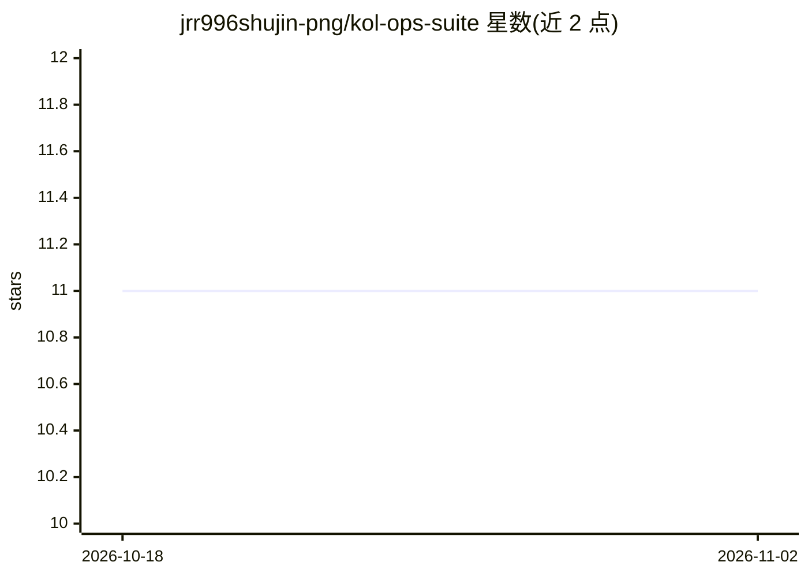

# jrr996shujin-png/kol-ops-suite

⭐ 11 · 推送 2026-03-03 · [GitHub](https://github.com/jrr996shujin-png/kol-ops-suite) · 个人维护

**面向 OpenClaw 代理的海外 KOL 营销全流程技能套件**

由 SKILL.md 主编排文件组织的 9 个可链式调用的技能，覆盖海外 KOL/网红营销全生命周期：CSV 清洗筛选、邮件触达追踪、三层数据策略的 KOL 深度评估、品牌知识库与个性化 brief 生成、内容 QC 与合规历史追踪、投放中期监控与评论分析、复盘与续约分层。通过自然语言指令由 OpenClaw/Claude Code 代理操作。数据来源组合 YouTube API 自动硬数据与 EasyKOL/Wednesday 插件人工输入，不可自动获取的字段标记 [MANUAL]；最终选择、谈判、审批、发送、预算决策保留给人工。安装方式为复制目录到 OpenClaw 工作区并在 AGENTS.md 中注册。

## 筛选速览

| 维度 | 判定 | 备注 |
|---|---|---|
| AI 角色 | `ai-ecosystem` | LLM/agent 周边工具 |
| 许可风险 | `none` | — |
| 部署形态 | `None` |  |
| 模型依赖 | — | README 未给出锁定关系 |
| 硬件要求 | — | 无带数字的原话,不猜 |
| 安装摩擦 | `low` | 无编译、无系统依赖或容器化 |
| 成熟度 | — | 结构信号不足 |

## 能力要点

- 9 个链式技能覆盖筛选→触达→评估→brief→QC→监控→评论分析→复盘全流程
- 三层数据策略：YouTube API 自动硬数据 + 插件人工输入，缺数据字段黄色高亮提示
- 持久化品牌知识库与 KOL 合规历史，供续约决策复用
- 中期监控以 KOL 自身历史均值为基准生成红黄绿日报警

## 适用场景

- 我想让 AI 代理替我筛选和评估从 NoxInfluencer 导出的 KOL 列表
- 投放进行中每天收到视频表现预警并调整未发布 KOL 的 brief
- 把评论区高频问题整理成 SEO/AEO 博客选题日历

## 场景标签

`Agent 框架` · 领域:Agent 开发

## 证据(README 行号)

> L1: # 🦞 KOL Ops Suite v3 — Composition Skill for OpenClaw / Claude Code
> L52: ├── SKILL.md                              # Master orchestrator (9-skill pipeline)
> L67: When I ask about KOL campaigns, influencer outreach, creator partnerships, campaign analytics, KOL briefs, content 

## 星数曲线

2026-10-18 11 → 2026-11-02 11（+0）

---
*卡片 v1 · prompt 1.4 · 生成 2026-11-02 · 置信度 high · 依据 README sha `c543fd2bcb92` · [字段定义](../../DATASET.md)*
