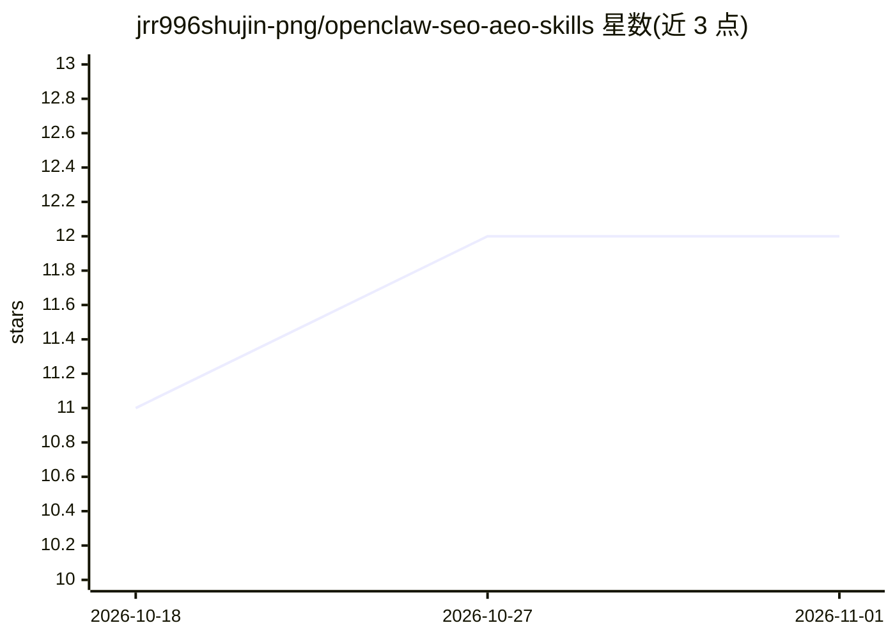

# jrr996shujin-png/openclaw-seo-aeo-skills

⭐ 12 · Shell · MIT · 推送 2026-02-26 · [GitHub](https://github.com/jrr996shujin-png/openclaw-seo-aeo-skills) · 个人维护

**给 OpenClaw 代理的 SEO/AEO 分析技能包：诊断、挖题、追踪、报告**

面向 OpenClaw 个人 AI 助手的三个技能包：aeo-content-strategy 从 Reddit/Quora 社区监测中挖掘长尾问题并生成内容策略；seo-aeo-diagnostics 对任意网站做 7 模块 100 分制健康检查（含 AI 爬虫可访问性、结构化数据等）；seo-competitive-intel 追踪 Google/Bing 关键词排名、内容表现与竞品动态并生成 React 月报。前两个技能无需 API key，第三个需 SEMrush、Google Search Console、GA4 凭据。通过 git clone 加 install.sh 安装至 ~/.openclaw/skills/。

## 筛选速览

| 维度 | 判定 | 备注 |
|---|---|---|
| AI 角色 | `ai-ecosystem` | LLM/agent 周边工具 |
| 许可风险 | `permissive` | MIT |
| 部署形态 | `None` |  |
| 模型依赖 | — | README 未给出锁定关系 |
| 硬件要求 | — | 无带数字的原话,不猜 |
| 安装摩擦 | `low` | 无编译、无系统依赖或容器化 |
| 成熟度 | — | 结构信号不足 |

## 能力要点

- 7 模块网站健康检查，覆盖技术 SEO 与 AI 就绪度
- Reddit/Quora 社区信号转化为 25+ 词长尾问题库
- Google/Bing 双引擎关键词排名追踪与竞品内容监测
- 月度 React 交互式报告（5 个标签页）

## 适用场景

- 让我的 AI 助手诊断网站的 SEO 与 AEO 就绪度
- 从 Reddit/Quora 挖掘用户真实提问以规划内容
- 持续追踪关键词排名与竞品发文并生成月报

## 场景标签

`网页抓取` `数据分析` · 领域:效率与自动化

## 证据(README 行号)

> L3: **SEO & AEO skill pack for OpenClaw — turn your personal AI assistant into an SEO/AEO analyst.**
> L7: This skill pack gives your OpenClaw agent the ability to:
> L185: |OpenClaw|Everything|v0.1+|

## 星数曲线

2026-10-18 11 → 2026-11-01 12（+1）

---
*卡片 v1 · prompt 1.4 · 生成 2026-11-01 · 置信度 high · 依据 README sha `07657d83fe38` · [字段定义](../../DATASET.md)*
