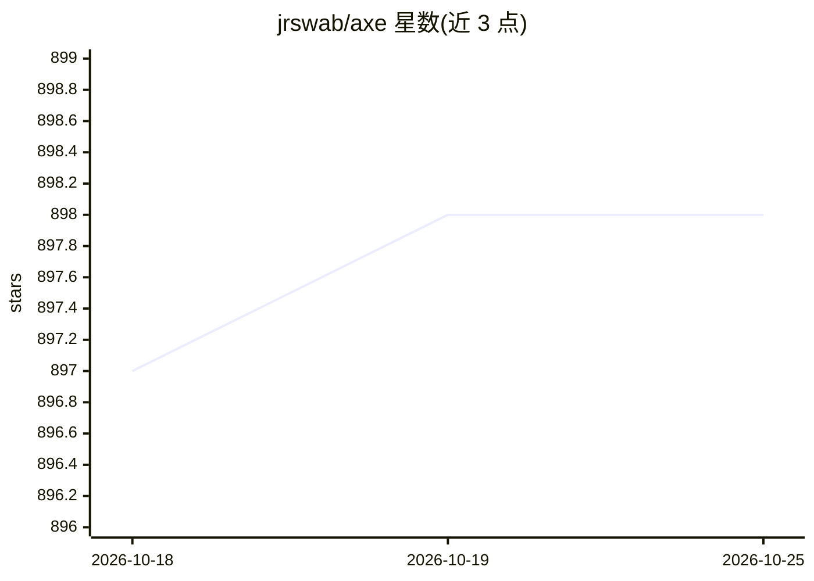

# jrswab/axe

⭐ 898 · Go · Apache-2.0 · 推送 2026-10-22 · [GitHub](https://github.com/jrswab/axe) · [官网](https://docs.getaxe.dev) · 个人维护

**用 TOML 定义单一用途 LLM agent 并随处触发的 CLI 工具**

Go 编写的命令行工具，用于管理和运行 LLM agent：每个 agent 用一个 TOML 文件声明系统提示、模型、技能文件、工作目录与记忆，通过 axe run 执行，支持 stdin 管道、子 agent 委派、MCP 外部工具、token 预算与 JSON 输出。定位为执行器而非调度器，设计为与 cron、git hooks、管道等 Unix 工具组合。提供 Linux/macOS/Windows 预编译二进制、Go 安装与 Docker 镜像，容器默认非 root、只读根文件系统等加固配置。

## 筛选速览

| 维度 | 判定 | 备注 |
|---|---|---|
| AI 角色 | `ai-ecosystem` | LLM/agent 周边工具 |
| 许可风险 | `permissive` | Apache-2.0 |
| 部署形态 | `desktop` | 安装包/桌面程序 |
| 模型依赖 | local-ok | 支持本地模型 |
| 硬件要求 | — | 无带数字的原话,不猜 |
| 安装摩擦 | `low` | 无编译、无系统依赖或容器化 |
| 成熟度 | — | 结构信号不足 |

## 能力要点

- 多 provider：Anthropic、OpenAI、Ollama、OpenCode、AWS Bedrock
- TOML 声明式 agent 配置与子 agent 委派（深度限制、并行执行）
- 持久记忆与 LLM 辅助的记忆垃圾回收
- 内置工具沙箱、SSRF 防护输出白名单、MCP 工具接入（SSE/streamable-HTTP）

## 适用场景

- 用 git diff 管道触发代码审查 agent
- 通过 cron 或 git hooks 定时运行单一用途 agent
- 在加固 Docker 容器中隔离运行 agent 并挂载持久记忆

## 场景标签

`Agent 框架` · 领域:Agent 开发

## 证据(README 行号)

> L5: A CLI tool for managing and running LLM-powered agents.
> L15: Axe orchestrates LLM-powered agents defined via TOML configuration files. Each agent has its own system prompt, mod
> L17: Axe is the executor, not the scheduler. It is designed to be composed with standard Unix tools — cron, git hooks, p

## 星数曲线

2026-10-18 897 → 2026-10-25 898（+1）

---
*卡片 v1 · prompt 1.4 · 生成 2026-10-21 · 置信度 high · 依据 README sha `1483e1041655` · [字段定义](../../DATASET.md)*
