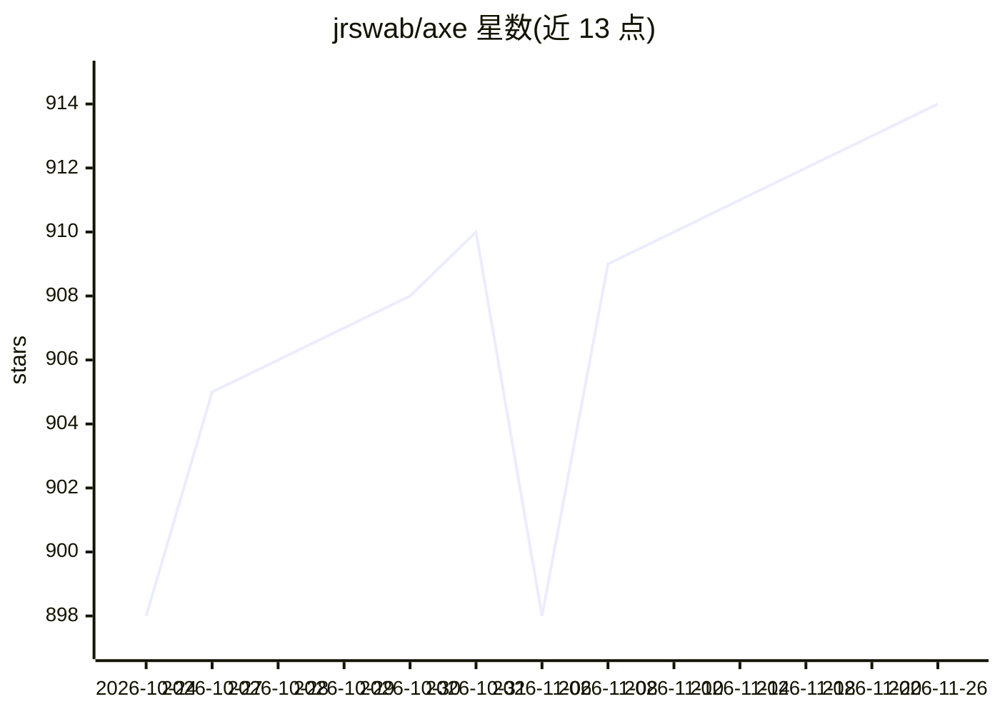

# jrswab/axe

⭐ 914 · Go · Apache-2.0 · 推送 2026-11-25 · [GitHub](https://github.com/jrswab/axe) · [官网](https://docs.getaxe.dev) · 个人维护

**以 TOML 定义、从命令行运行单一职责 LLM agent 的 CLI**

Go 编写的命令行工具，用于定义并运行 LLM 驱动的 agent：每个 agent 在 TOML 文件中声明系统提示、模型、技能文件、上下文、工作目录与持久记忆，可通过 stdin 管道、git hooks、cron 等既有 Unix 机制触发，不自带调度器或 GUI。内置沙箱化文件操作、shell 执行、URL 抓取与 web search 工具，支持子 agent 委托、token 预算、MCP 工具接入与 JSON 结构化输出。提供 Linux/macOS/Windows 预编译二进制、go install、源码构建与 Docker 镜像（含 compose 加固配置）。

## 筛选速览

| 维度 | 判定 | 备注 |
|---|---|---|
| AI 角色 | `ai-ecosystem` | LLM/agent 周边工具 |
| 许可风险 | `permissive` | Apache-2.0 |
| 部署形态 | `desktop` | 安装包/桌面程序 |
| 模型依赖 | local-ok | 支持本地模型 |
| 硬件要求 | — | 无带数字的原话,不猜 |
| 安装摩擦 | `low` | 无编译、无系统依赖或容器化 |
| 成熟度 | — | 结构信号不足 |

## 能力要点

- TOML 声明式 agent 配置，支持子 agent 委托与并行执行
- stdin 管道输入（git diff | axe run reviewer）与 JSON 输出便于脚本化
- 内置沙箱文件操作/shell/URL 抓取/web search，含 SSRF 防护与 token 预算
- MCP 工具接入（SSE/streamable-HTTP）与 Docker 加固容器运行

## 适用场景

- 把代码审查、提交信息生成、日志分析做成可管道调用的命令行 agent
- 用 cron 或 git hooks 在既有工作流中定时/自动触发 LLM 任务
- 本地 Ollama 模型搭配 compose 容器运行隔离 agent

## 场景标签

`代码审查` `Agent 框架` · 领域:Agent 开发

## 证据(README 行号)

> L5: A CLI tool for managing and running LLM-powered agents.
> L15: Axe orchestrates LLM-powered agents defined via TOML configuration files. Each agent has its own system prompt, mod
> L23: - **Multi-provider support** — Anthropic, OpenAI, Ollama (local models), OpenCode, and AWS Bedrock

## 星数曲线

2026-10-24 898 → 2026-11-26 914（+16）

---
*卡片 v1 · prompt 1.4 · 生成 2026-11-25 · 置信度 high · 依据 README sha `633a785ae6a9` · [字段定义](../../DATASET.md)*
