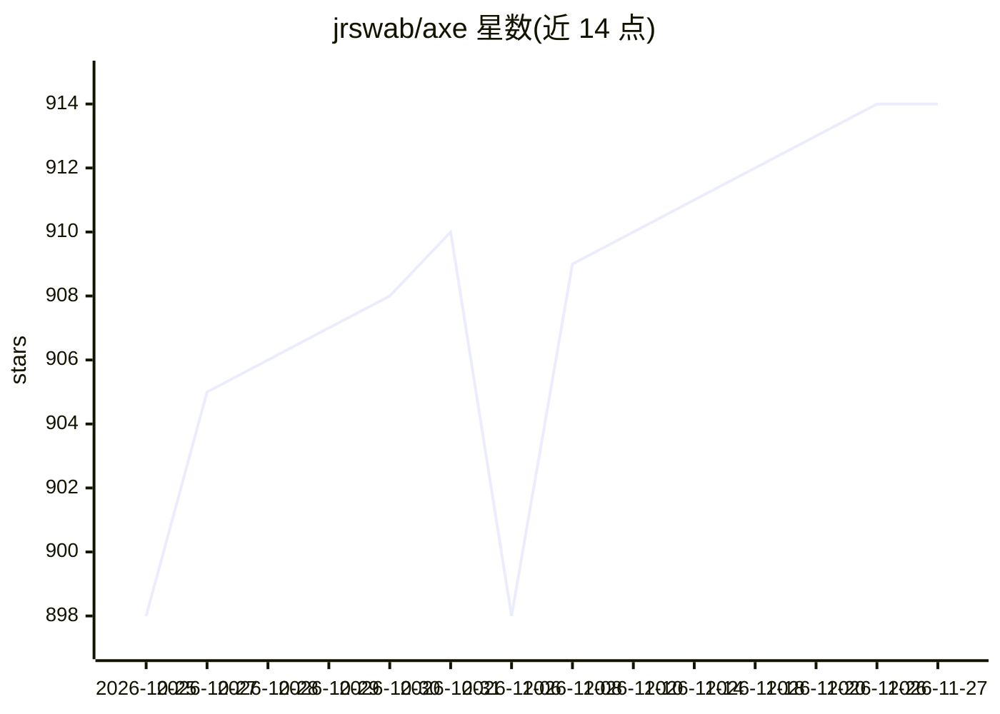

# jrswab/axe

⭐ 914 · Go · Apache-2.0 · 推送 2026-11-26 · [GitHub](https://github.com/jrswab/axe) · [官网](https://docs.getaxe.dev) · 个人维护

**用 TOML 定义并运行单一职责 LLM agent 的 CLI 工具**

以 Unix 组合工具思路运行的 agent 执行器：每个 agent 用 TOML 文件定义系统提示、模型、技能文件、工作目录与持久记忆，通过命令行调用，可从 stdin 管道、git hooks、cron 或 CI 触发。支持子 agent 委派（深度限制与并行）、记忆垃圾回收、token 预算、SSRF 防护与 MCP 工具接入。定位为执行器而非调度器，无守护进程与 GUI；源码构建需 Go 1.26.11+，也可用预编译二进制或 Docker 镜像。

## 筛选速览

| 维度 | 判定 | 备注 |
|---|---|---|
| AI 角色 | `ai-ecosystem` | LLM/agent 周边工具 |
| 许可风险 | `permissive` | Apache-2.0 |
| 部署形态 | `desktop` | 安装包/桌面程序 |
| 模型依赖 | local-ok | 支持本地模型 |
| 硬件要求 | — | 无带数字的原话,不猜 |
| 安装摩擦 | `low` | 无编译、无系统依赖或容器化 |
| 成熟度 | — | 结构信号不足 |

## 能力要点

- TOML 声明式 agent 配置，支持 stdin 管道输入（git diff | axe run）
- 子 agent 委派与并行执行、持久化 markdown 记忆及 LLM 辅助垃圾回收
- 内置沙箱化文件操作、shell 执行、URL 抓取与 web 搜索工具，支持 MCP 服务器
- token 预算、重试退避、dry-run 与 JSON 结构化输出

## 适用场景

- 在 CI 或 git hooks 中自动执行代码审查与提交信息生成
- 用 cron 定时触发日志分析等一次性 agent 任务
- 通过管道把命令行输出直接交给 agent 处理
- 需要版本控制的声明式 agent 定义并接入 MCP 工具的团队

## 场景标签

`代码审查` `Agent 框架` · 领域:Agent 开发

## 证据(README 行号)

> L11: Axe treats LLM agents the same way Unix treats programs. Each agent does one thing well. You define it in a TOML fi
> L15: Axe orchestrates LLM-powered agents defined via TOML configuration files. Each agent has its own system prompt, mod
> L17: Axe is the executor, not the scheduler. It is designed to be composed with standard Unix tools — cron, git hooks, p

## 星数曲线

2026-10-25 898 → 2026-11-27 914（+16）

---
*卡片 v1 · prompt 1.4 · 生成 2026-11-27 · 置信度 high · 依据 README sha `ca617a25e3ce` · [字段定义](../../DATASET.md)*
