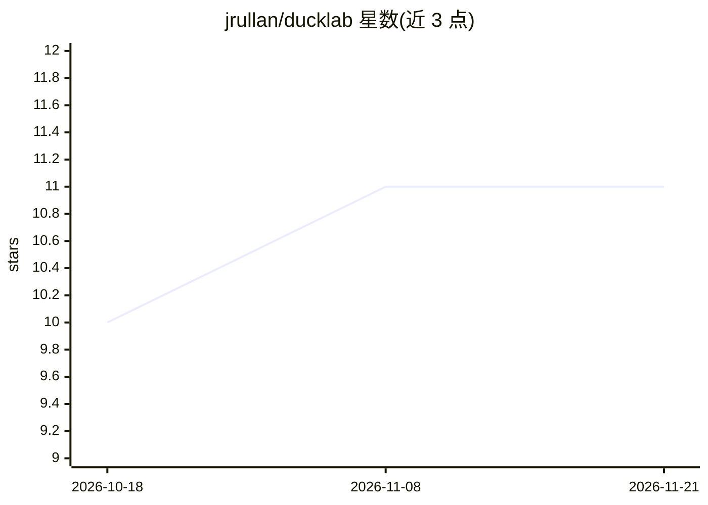

# jrullan/ducklab

⭐ 11 · Go · Apache-2.0 · 推送 2026-11-19 · [GitHub](https://github.com/jrullan/ducklab) · 个人维护

**自托管多 LLM 开发流水线：以测试门禁约束模型写码全程**

用 Go 编写的自托管开发 harness：从 brief 依次产出需求、规格、计划、任务并实现，经真实测试门禁后才可能提交，人可在各阶段 accept/reject。多个模型分席协作（架构/评审/盲评），所有模型调用与决策留痕，验收通过附带可第三方复验的 receipt。本地优先支持 llama.cpp、vLLM 及 OpenAI 兼容/Anthropic 端点；提供 CLI、桌面端与已注册的 MCP server。当前版本 v0.7.0+，桌面端仅在 Linux 上经日常验证，macOS 桌面构建未经验证。

## 筛选速览

| 维度 | 判定 | 备注 |
|---|---|---|
| AI 角色 | `ai-ecosystem` | LLM/agent 周边工具 |
| 许可风险 | `permissive` | Apache-2.0 |
| 部署形态 | `None` |  |
| 模型依赖 | local-ok | 支持本地模型 |
| 硬件要求 | — | 无带数字的原话,不猜 |
| 安装摩擦 | `medium` | 含编译或系统依赖之一 |
| 成熟度 | `idea` | |

## 能力要点

- 七阶段流程（brief→requirements→spec→plan→build→review→release）配人工门禁
- 判定依据为命令退出码而非模型意见，accept 需从干净 checkout 复现绿色门禁
- 每席模型有基于自身运行的 pass率/成本记分卡，本地模型以 $0 成本参与排序
- 经 MCP server 注册于官方 MCP registry，可由其他 agent 操作

## 适用场景

- 用多个本地廉价模型跑带测试门禁的编码任务流水线
- 要求每次代码合入都有可复验的验收凭证
- 让其他 agent 通过 MCP 操作开发循环并留下归因记录

## 场景标签

`多智能体` `代码生成` `代码审查` `推理引擎` · 领域:Agent 开发

## 证据(README 行号)

> L6: **In one block:** self-hosted development harness (Go engine + CLI + desktop,
> L8: verdicts are exit codes, never model opinions · local models first (llama.cpp,
> L94: autopilot, a CLI, a desktop app, and an MCP server — in the

## 星数曲线

2026-10-18 10 → 2026-11-21 11（+1）

---
*卡片 v1 · prompt 1.4 · 生成 2026-11-18 · 置信度 high · 依据 README sha `921f06fbbfae` · [字段定义](../../DATASET.md)*
