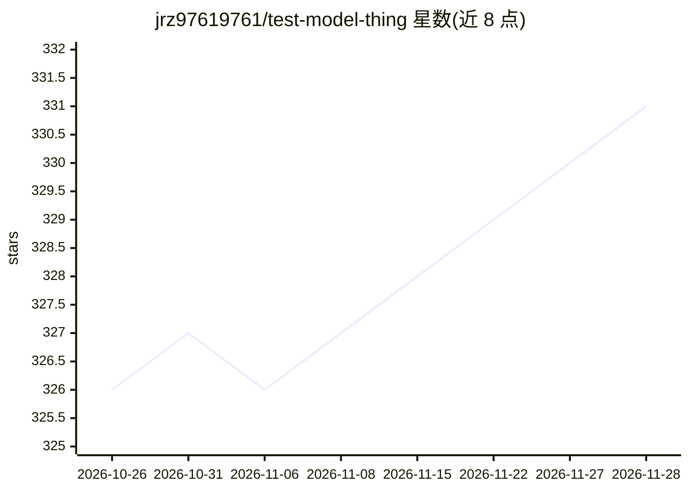

# jrz97619761/test-model-thing

⭐ 331 · Python · MIT · 推送 2026-11-27 · [GitHub](https://github.com/jrz97619761/test-model-thing) · 个人维护

**基于 MLX 的语言模型架构实验与训练 CLI 框架**

TMT 是一个基于 Apple MLX 的语言模型实验框架与命令行工具，用于尝试替代性架构与分布式训练。当前包含 RTU 启发的 RNN 块、可插拔层/损失函数基础框架、BPE 分词支持、CoLA 与 bit-per-byte 基准，以及支持尺寸/块组合扫描的 CLI。规划中的功能包括循环块目录、设备端并行训练、RL 与去中心化训练。项目处于早期阶段，运行于 Apple Silicon、Linux/WSL（CUDA GPU 或 CPU），暂不支持 AMD。

## 筛选速览

| 维度 | 判定 | 备注 |
|---|---|---|
| AI 角色 | `ai-ecosystem` | LLM/agent 周边工具 |
| 许可风险 | `permissive` | MIT |
| 部署形态 | `library` | 以包/库形式分发 |
| 模型依赖 | — | README 未给出锁定关系 |
| 硬件要求 | — | 无带数字的原话,不猜 |
| 安装摩擦 | `medium` | 含编译或系统依赖之一 |
| 成熟度 | `idea` | |

## 能力要点

- RTU 启发的 RNN 块，替代 BPTT 的训练方式
- 可插拔层/块与损失函数的基础框架，直接接入默认编码器与解码器
- CLI 支持训练、基准测试及尺寸/块组合扫描
- 支持 Apple Silicon、Linux/WSL 的 CUDA GPU 或 CPU

## 适用场景

- 在消费级硬件上实验替代性语言模型架构
- 对模型尺寸与模块组合做批量扫描对比
- 参与开放训练代码与数据的开源模型实验

## 场景标签

 · 领域:机器学习/模型训练框架

## 证据(README 行号)

> L9: TMT is a work-in-progress MLX-based framework and command-line tool for experimenting with alternative language mode
> L27: * A command-line tool for training and benchmarking language models using these alternative designs, alongside swee

## 星数曲线

2026-10-26 326 → 2026-11-28 331（+5）

---
*卡片 v1 · prompt 1.4 · 生成 2026-11-27 · 置信度 high · 依据 README sha `f23e9d20d37d` · [字段定义](../../DATASET.md)*
