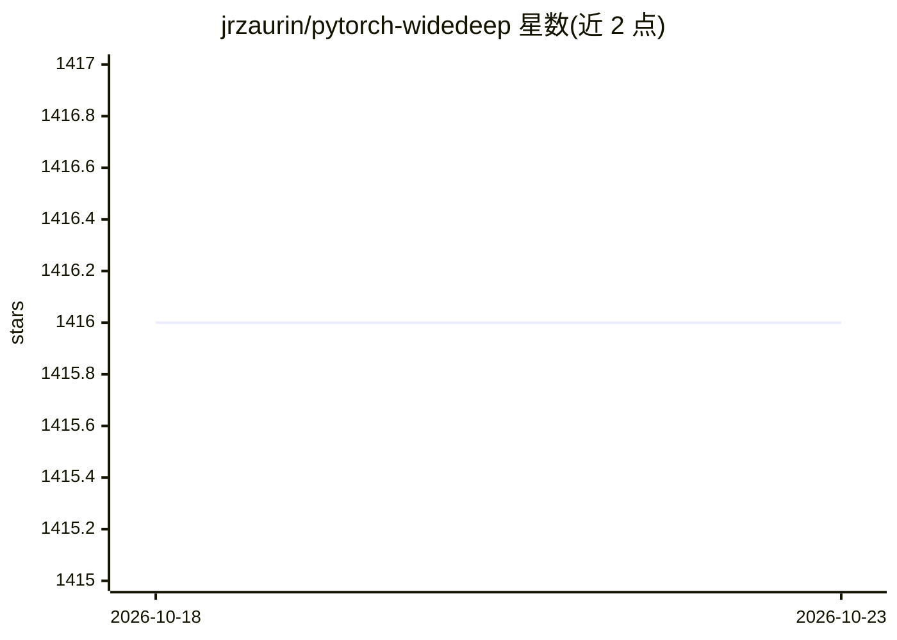

# jrzaurin/pytorch-widedeep

⭐ 1,416 · Python · Apache-2.0 · 推送 2026-04-30 · [GitHub](https://github.com/jrzaurin/pytorch-widedeep) · 个人维护

**PyTorch 多模态深度学习库：表格数据结合文本与图像建模**

基于 Google Wide and Deep 算法调整用于多模态数据集的 Python 库，面向用深度学习处理表格数据的开发者。提供 wide、deeptabular、deeptext、deepimage 四个可独立使用的组件：表格组件含 TabMlp、TabNet、TabTransformer、SAINT、FT-Transformer、贝叶斯模型等十余种；文本组件含 RNN 系列与 Hugging Face 模型包装器；另含推荐系统 rec 模块（DeepFM、xDeepFM、AutoInt 等）。支持自定义组件（需带 output_dim 属性）、两塔模型、多目标损失与自监督预训练。以 pip 包分发，配 readthedocs 文档与示例代码。

## 筛选速览

| 维度 | 判定 | 备注 |
|---|---|---|
| AI 角色 | `ai-native` | 本体是模型或模型工具 |
| 许可风险 | `permissive` | Apache-2.0 |
| 部署形态 | `library` | 以包/库形式分发 |
| 模型依赖 | — | README 未给出锁定关系 |
| 硬件要求 | — | 无带数字的原话,不猜 |
| 安装摩擦 | `low` | 无编译、无系统依赖或容器化 |
| 成熟度 | — | 结构信号不足 |

## 能力要点

- wide/deeptabular/deeptext/deepimage 四组件可独立或组合使用
- deeptabular 提供 TabMlp、TabNet、TabTransformer、SAINT、FT-Transformer、贝叶斯模型等十余种模型
- rec 推荐系统模块含 DeepFM、xDeepFM、AutoInt、DCN V2 等 10 种算法
- 支持自定义组件、ModelFuser 融合、两塔模型与自监督预训练

## 适用场景

- 在含类别/连续特征的表格数据上训练深度学习模型
- 将表格数据与文本、图像列组合做多模态建模
- 构建 CTR 预估与推荐系统的两塔或 FM 系模型

## 场景标签

`推荐系统` `多模态` · 领域:学习与行业

## 证据(README 行号)

> L14: A flexible package for multimodal-deep-learning to combine tabular data with
> L34: In general terms, `pytorch-widedeep` is a package to use deep learning with
> L36: text and images with corresponding tabular data using wide and deep models.

## 星数曲线

2026-10-18 1,416 → 2026-10-23 1,416（+0）

---
*卡片 v1 · prompt 1.4 · 生成 2026-10-21 · 置信度 high · 依据 README sha `087a51349136` · [字段定义](../../DATASET.md)*
