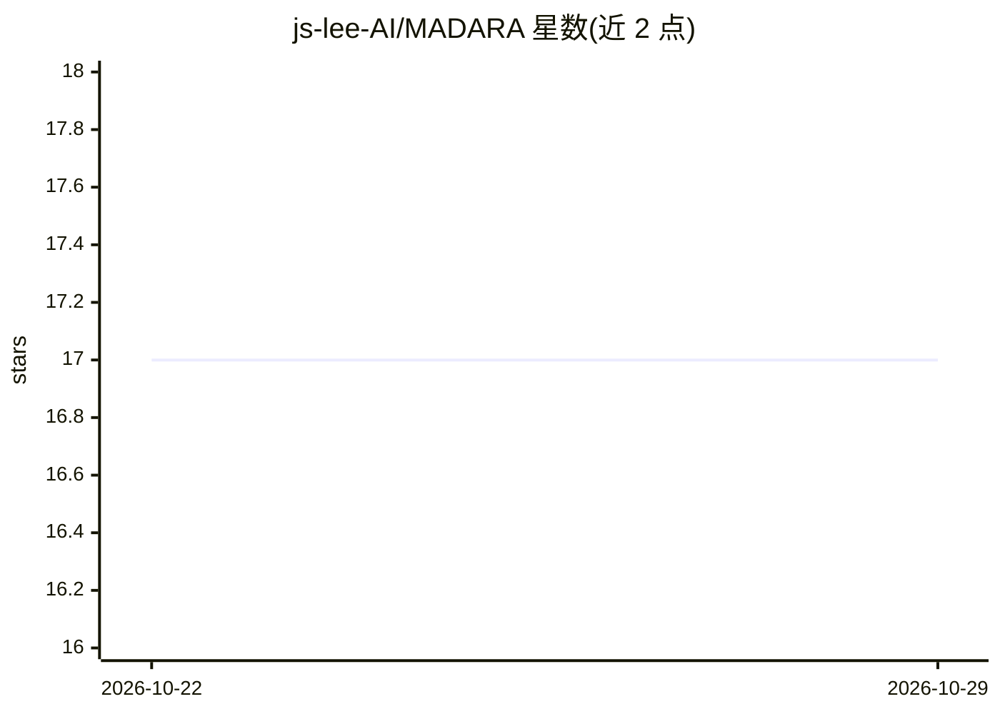

# js-lee-AI/MADARA

⭐ 17 · Python · MIT · 推送 2026-10-11 · [GitHub](https://github.com/js-lee-AI/MADARA) · [官网](https://js-lee-ai.github.io/MADARA/) · 组织维护

**免训练的多智能体 RAG 文档评估路由框架，降低推理成本**

论文《To Isolate or to Score?》的参考实现：免训练流水线，先用 RSC 扰动探针诊断模型-任务对的评分行为，再按固定阈值将输入路由到最省成本的文档评估处理（PDE 逐文档隔离投票 / SDA 分数分布对齐 / CoT 去极化 / ATF 自适应阈值过滤）。后端无关，任何实现 chat 方法的模型客户端（本地 vLLM/transformers 或托管 API）均可接入。基准数据集不随仓库分发，需自行获取。

## 筛选速览

| 维度 | 判定 | 备注 |
|---|---|---|
| AI 角色 | `ai-ecosystem` | LLM/agent 周边工具 |
| 许可风险 | `permissive` | MIT |
| 部署形态 | `library` | 以包/库形式分发 |
| 模型依赖 | — | README 未给出锁定关系 |
| 硬件要求 | — | 无带数字的原话,不猜 |
| 安装摩擦 | `low` | 无编译、无系统依赖或容器化 |
| 成熟度 | — | 结构信号不足 |

## 能力要点

- RSC 无标签扰动探针（shuffle/contrad/randomize）判定评分为推理驱动或随机
- 按诊断结果路由到四种文档评估处理之一，阈值来自单个 Mistral-7B 试点并零样本应用
- 模型客户端后端无关，实现 chat 方法即可接入
- 在 5 个 7B-9B 开源模型上自动选路，弱基线模型 CONFLICTS 提升达 +36.3pp

## 适用场景

- 为多智能体 RAG 选择成本更低的文档评估策略
- 诊断 LLM 文档评分是推理驱动还是随机
- 降低多智能体文档评估的推理调用次数

## 场景标签

`多智能体` `RAG` · 领域:Agent 开发

## 证据(README 行号)

> L30: **MADARA** is the reference implementation of a **training-free** pipeline for cost-efficient multi-agent retrieval
> L98: See `madara/model_client.py` for the abstract base class and a mock used by the example. Implement it for your mode

## 星数曲线

2026-10-22 17 → 2026-10-29 17（+0）

---
*卡片 v1 · prompt 1.4 · 生成 2026-10-29 · 置信度 mid · 依据 README sha `28e666f2cf9f` · [字段定义](../../DATASET.md)*
