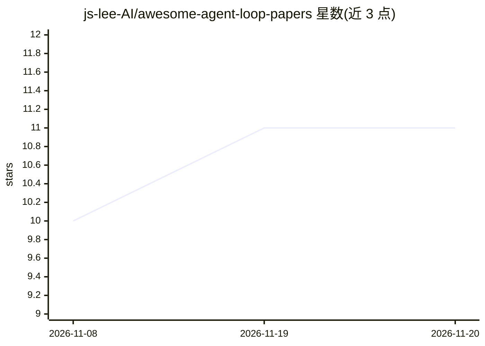

# js-lee-AI/awesome-agent-loop-papers

⭐ 11 · NOASSERTION · 推送 2026-11-04 · [GitHub](https://github.com/js-lee-AI/awesome-agent-loop-papers) · [官网](https://github.com/js-lee-AI/awesome-llm-agent-papers) · 个人维护

**面向 agent 研究者与工程师的 agent loop 论文与开源资源阅读清单**

配套综述《The Agent Loop》的策展清单：索引 565 篇论文（385 篇来自综述正文，180 篇为另行策展并经 arXiv 核验）与 100 个开源工件，按控制策略、训练循环、机制（终止/验证/上下文/恢复）、技能、harness、评测与安全等综述章节组织。另维护一张实时更新的高星开源工件目录，覆盖框架、编码 harness、记忆与上下文基础设施、沙箱、工具服务、技能库及训练评测工具。内容以 CC BY 4.0 发布，接受 PR 贡献。

## 筛选速览

| 维度 | 判定 | 备注 |
|---|---|---|
| AI 角色 | `ai-knowledge` | 知识聚合/清单类 |
| 许可风险 | `none` | NOASSERTION |
| 部署形态 | `self-host` | docker 或自建部署 |
| 模型依赖 | — | README 未给出锁定关系 |
| 硬件要求 | — | 无带数字的原话,不猜 |
| 安装摩擦 | `low` | 无编译、无系统依赖或容器化 |
| 成熟度 | — | 结构信号不足 |

## 能力要点

- 索引 565 篇论文与 100 个开源工件，按综述章节组织
- 开源工件按框架/harness、记忆上下文、技能库、训练评测四类编目
- 配套 SSRN 综述论文，仓库内含 59 页 PDF
- 无论文的高星工件（如 Claude Code、AutoGPT）可引用本表作为参考出处

## 适用场景

- 系统了解 LLM agent 的控制策略与训练方法研究脉络
- 为 agent 项目挑选记忆、上下文、沙箱等基础设施组件
- 查找 agent 评测与安全方向的论文与工具

## 场景标签

`精选清单` · 领域:学习与行业

## 证据(README 行号)

> L3:  565 papers and 100 open-source artifacts on the agent loop : the reading list for
> L19: Curated, section-organized reading list and artifact catalog for the survey
> L27: Currently indexing **565 papers** (385 cited in the survey text plus 180 additional curated 2026 papers, each verif

## 星数曲线

2026-11-08 10 → 2026-11-20 11（+1）

---
*卡片 v1 · prompt 1.4 · 生成 2026-11-19 · 置信度 mid · 依据 README sha `7d5f5fa91cd6` · [字段定义](../../DATASET.md)*
