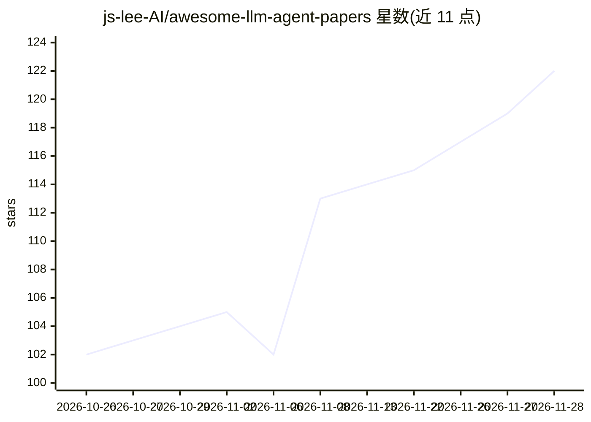

# js-lee-AI/awesome-llm-agent-papers

⭐ 122 · Python · MIT · 推送 2026-11-27 · [GitHub](https://github.com/js-lee-AI/awesome-llm-agent-papers) · 个人维护 · 中文 README

**LLM 智能体论文精选清单：规划/记忆/工具/多智能体等 228+ 篇**

作为配套综述《LLM Agents: A Survey》的论文清单仓库，收录 228 篇综述参考文献及后续新增论文，按综述结构分为 Surveys、Architectures、Planning、Memory、Tool Use、Multi-Agent、Environments、Applications、Evaluation、Safety 共 10 个章节。每条条目附一句话贡献说明、发表会议/年份，有官方实现时附 [code] 链接。另提供 10 篇入门 Starter Kit、2026 年关注列表、可折叠目录索引，并以 MIT 许可发布，接受 PR 更新。

## 筛选速览

| 维度 | 判定 | 备注 |
|---|---|---|
| AI 角色 | `ai-knowledge` | 知识聚合/清单类 |
| 许可风险 | `permissive` | MIT |
| 部署形态 | `None` |  |
| 模型依赖 | — | README 未给出锁定关系 |
| 硬件要求 | — | 无带数字的原话,不猜 |
| 安装摩擦 | `low` | 无编译、无系统依赖或容器化 |
| 成熟度 | — | 结构信号不足 |

## 能力要点

- 228+ 篇论文按综述分类法组织为 10 个功能章节
- 每条附一句话注释、venue/年份与官方实现 [code] 链接
- 10 篇 Starter Kit 入门清单与按章节计数的可折叠目录
- 配套 GitBook 在线书籍与后续 Agent Loop 论文清单（524 篇）

## 适用场景

- 系统入门 LLM agent 研究领域，按 Starter Kit 顺序阅读
- 为规划、记忆、工具调用等具体方向查找代表性论文与官方代码
- 撰写综述或调研报告时快速定位相关文献

## 场景标签

`精选清单` · 领域:学习与行业

## 证据(README 行号)

> L5:  200+ must-read papers, updated regularly : the annotated reading list for building
> L28: |🧭 **Organized by function**|10 sections following the survey's structure: Surveys, Architectures, Planning, Memory
> L39: This repository collects must-read papers on **LLM-based agents**: language models equipped with planning, memory, 

## 星数曲线

2026-10-26 102 → 2026-11-28 122（+20）

---
*卡片 v1 · prompt 1.4 · 生成 2026-11-28 · 置信度 high · 依据 README sha `b5442399a48c` · [字段定义](../../DATASET.md)*
