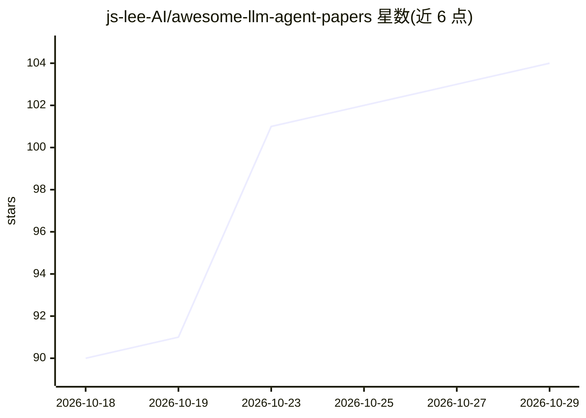

# js-lee-AI/awesome-llm-agent-papers

⭐ 104 · Python · MIT · 推送 2026-10-27 · [GitHub](https://github.com/js-lee-AI/awesome-llm-agent-papers) · 个人维护 · 中文 README

**面向 LLM Agent 研究者的 curated 论文清单（228+ 篇）**

作为综述论文 'LLM Agents: A Survey' 的配套阅读清单，收录 228 篇及以上关于 LLM 智能体的论文，覆盖综述、架构、规划、记忆、工具使用、多智能体、环境、应用、评测与安全 10 个板块，并在持续补充综述发表后的新论文。每个条目附一行贡献注释、发表会议与年份，以及官方实现的代码链接（如有）。另提供 10 篇入门 Starter Kit、2026 年新论文关注列表和 GitBook 在线书版本。多语言 README（含简体中文、韩语、日语等）。

## 筛选速览

| 维度 | 判定 | 备注 |
|---|---|---|
| AI 角色 | `ai-knowledge` | 知识聚合/清单类 |
| 许可风险 | `permissive` | MIT |
| 部署形态 | `None` |  |
| 模型依赖 | — | README 未给出锁定关系 |
| 硬件要求 | — | 无带数字的原话,不猜 |
| 安装摩擦 | `low` | 无编译、无系统依赖或容器化 |
| 成熟度 | — | 结构信号不足 |

## 能力要点

- 228+ 篇论文按综述分类法的 10 个板块组织
- 每条目附一行贡献注释、venue/年份与官方代码链接
- 10 篇论文的 Starter Kit 入门清单
- 配套 GitBook 在线书与姊妹清单 Awesome Agent Loop Papers

## 适用场景

- 系统性地阅读 LLM Agent 领域的核心论文
- 按规划/记忆/工具使用等主题查找特定方向的研究文献
- 新人通过 Starter Kit 快速入门 agent 研究

## 场景标签

`精选清单` `科研工具` · 领域:学习与行业

## 证据(README 行号)

> L5:  200+ must-read papers, updated regularly : the annotated reading list for building
> L9: 200+ curated papers
> L27: |📚 **A superset of the survey**|The 228 references behind *“LLM Agents: A Survey,”* plus papers that came out after

## 星数曲线

2026-10-18 90 → 2026-10-29 104（+14）

---
*卡片 v1 · prompt 1.4 · 生成 2026-10-23 · 置信度 high · 依据 README sha `368082982c7a` · [字段定义](../../DATASET.md)*
