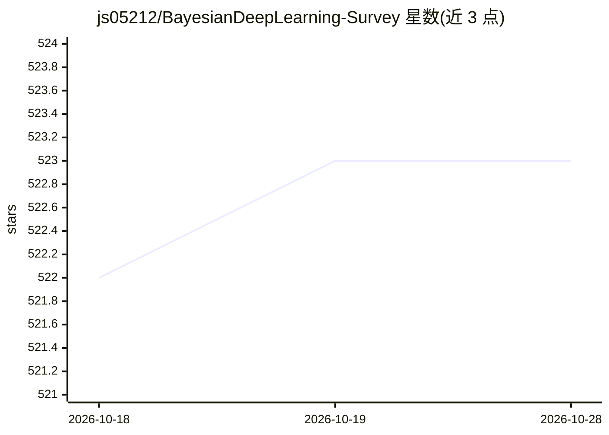

# js05212/BayesianDeepLearning-Survey

⭐ 523 · 推送 2026-07-04 · [GitHub](https://github.com/js05212/BayesianDeepLearning-Survey) · 个人维护

**贝叶斯深度学习论文综述清单：按领域持续更新收录 BDL 论文**

学术论文文献清单仓库，是 ACM Computing Surveys 2020 论文 'A Survey on Bayesian Deep Learning' 的持续更新版本。按研究主题组织论文条目，覆盖推荐系统、领域适应与元学习、医疗健康、NLP、计算机视觉等方向，每条包含论文标题、作者、发表会议/期刊与 PDF 链接，部分条目附代码与数据集链接。面向研究人员与研究生，用于跟踪 BDL 领域的论文进展。内容以文献链接为主，不含可安装运行的软件代码。

## 筛选速览

| 维度 | 判定 | 备注 |
|---|---|---|
| AI 角色 | `ai-knowledge` | 知识聚合/清单类 |
| 许可风险 | `none` | — |
| 部署形态 | `None` |  |
| 模型依赖 | — | README 未给出锁定关系 |
| 硬件要求 | — | 无带数字的原话,不猜 |
| 安装摩擦 | `low` | 无编译、无系统依赖或容器化 |
| 成熟度 | — | 结构信号不足 |

## 能力要点

- ACM Computing Surveys 2020 综述的持续更新版本
- 按推荐系统/领域适应/医疗/NLP/计算机视觉等主题组织论文
- 部分条目附代码仓库与数据集链接（如 CDL 的 MXNet/TensorFlow 实现）

## 适用场景

- 查找贝叶斯深度学习各方向的代表性论文
- 跟踪 BDL 综述发布后的新论文进展
- 获取论文配套的代码与数据集入口

## 场景标签

`精选清单` · 领域:学习与行业

## 证据(README 行号)

> L1: # An Updating Survey for Bayesian Deep Learning (BDL)
> L3: This is an updating survey for Bayesian Deep Learning (BDL), an constantly updated and extended version for the manu

## 星数曲线

2026-10-18 522 → 2026-10-28 523（+1）

---
*卡片 v1 · prompt 1.4 · 生成 2026-10-21 · 置信度 high · 依据 README sha `dd9f4b870ca2` · [字段定义](../../DATASET.md)*
