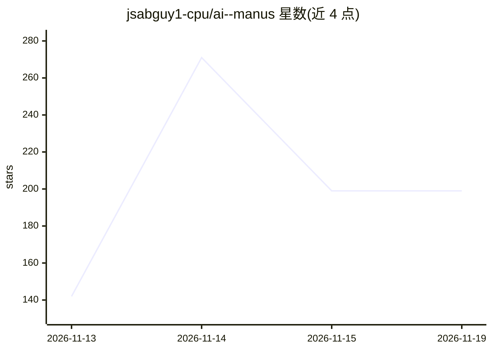

# jsabguy1-cpu/ai--manus

⭐ 199 · Apache-2.0 · 推送 2026-11-18 · [GitHub](https://github.com/jsabguy1-cpu/ai--manus) · 个人维护

**面向个人用户的自主 AI Agent：代为执行代码与浏览器操作**

一个自主运行 AI Agent 系统的描述页：Agent 可自动执行代码、控制浏览器导航网页、填写表单、收集信息，并处理多步骤任务，定位为面向家庭、学习与轻量办公的个人助手场景。README 提供最低软硬件要求表（64 位系统、双核 CPU、4 GB 内存）与六步使用流程说明，但页面未给出实际的下载链接、安装命令或源码入口，仅有推广码文字。

## 筛选速览

| 维度 | 判定 | 备注 |
|---|---|---|
| AI 角色 | `ai-native` | 本体是模型或模型工具 |
| 许可风险 | `permissive` | Apache-2.0 |
| 部署形态 | `None` |  |
| 模型依赖 | — | README 未给出锁定关系 |
| 硬件要求 | — | 无带数字的原话,不猜 |
| 安装摩擦 | `low` | 无编译、无系统依赖或容器化 |
| 成熟度 | — | 结构信号不足 |

## 能力要点

- 自主执行代码与控制浏览器完成多步骤任务
- 跨会话保持任务模式并重复应用
- 标注最低硬件要求（双核 CPU、4 GB 内存）

## 适用场景

- 让学生代为整理研究笔记和运行快速计算
- 让 Agent 从多个网页收集数据并汇总
- 把重复的文件检查和页面核对交给后台运行

## 场景标签

`AI 助手` `浏览器自动化` · 领域:效率与自动化

## 证据(README 行号)

> L18: Manus is an autonomous AI agent designed to run code and control a browser on your behalf. Instead of acting like a
> L37: |Component|Minimum|Recommended|
> L45: ## Starting with Manus

## 星数曲线

2026-11-13 142 → 2026-11-19 199（+57）

---
*卡片 v1 · prompt 1.4 · 生成 2026-11-19 · 置信度 high · 依据 README sha `c06c32a8c955` · [字段定义](../../DATASET.md)*
