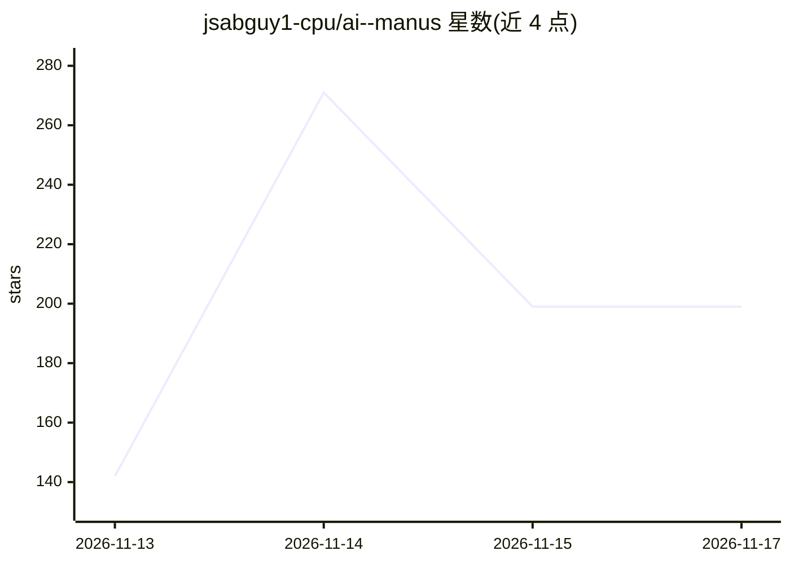

# jsabguy1-cpu/ai--manus

⭐ 199 · Apache-2.0 · 推送 2026-11-15 · [GitHub](https://github.com/jsabguy1-cpu/ai--manus) · 个人维护

**面向日常小任务的自主 AI Agent，运行代码并控制浏览器**

Manus 定位为自主 AI agent，代替用户执行代码与浏览器操作：编写并运行脚本、打开网页、填写表单、执行多步骤任务。目标是家庭、学习与轻量办公场景，强调无需编程背景。README 提供系统兼容性表（最低双核 CPU、4 GB 内存）、六步上手流程与适用场景列表，但未给出具体的安装命令、模型接入方式或源码/发布物说明；下载仅提及 'Download Manus' 与一段优惠码文本。

## 筛选速览

| 维度 | 判定 | 备注 |
|---|---|---|
| AI 角色 | `ai-native` | 本体是模型或模型工具 |
| 许可风险 | `permissive` | Apache-2.0 |
| 部署形态 | `None` |  |
| 模型依赖 | — | README 未给出锁定关系 |
| 硬件要求 | — | 无带数字的原话,不猜 |
| 安装摩擦 | `low` | 无编译、无系统依赖或容器化 |
| 成熟度 | — | 结构信号不足 |

## 能力要点

- 自主执行代码与脚本（autonomous code execution）
- 浏览器控制：导航网页、填表、采集信息
- 代码与浏览器操作可在同一任务流中衔接
- 面向家庭/学习/轻办公的小规模任务设计

## 适用场景

- 让学生整理研究笔记、跑小脚本与快速计算
- 让 agent 代为浏览网页、填表、跨页面收集资料
- 把重复性日常小任务委托给后台助手执行

## 场景标签

`浏览器自动化` `编码 Agent` `AI 助手` · 领域:效率与自动化

## 证据(README 行号)

> L10: - **Autonomous Code Execution:** Manus AI agent runs code on its own to complete tasks, so you can focus on decisio
> L18: Manus is an autonomous AI agent designed to run code and control a browser on your behalf. Instead of acting like a
> L22: Manus is not a heavy studio suite or a complex enterprise platform. It is a focused helper built for home, study, a

## 星数曲线

2026-11-13 142 → 2026-11-17 199（+57）

---
*卡片 v1 · prompt 1.4 · 生成 2026-11-17 · 置信度 mid · 依据 README sha `0f78ee3a5dd2` · [字段定义](../../DATASET.md)*
