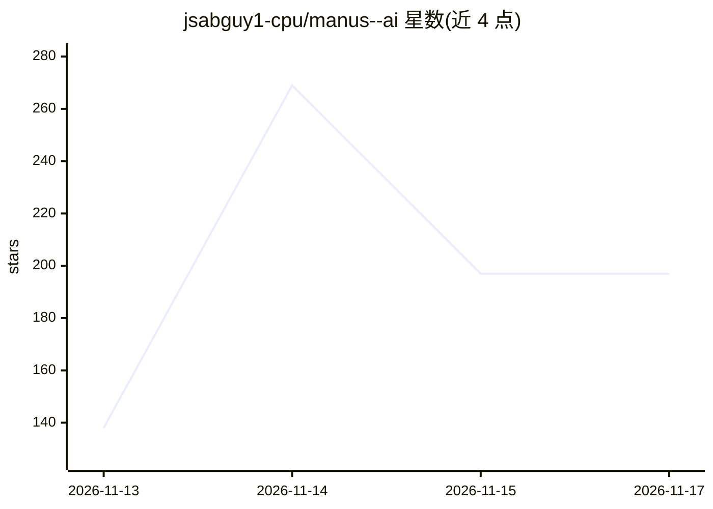

# jsabguy1-cpu/manus--ai

⭐ 197 · Apache-2.0 · 推送 2026-11-15 · [GitHub](https://github.com/jsabguy1-cpu/manus--ai) · 个人维护

**面向日常小任务的自主 AI Agent：代用户写代码与操控浏览器**

自主式 AI Agent 产品说明：接收自然语言指令后代为编写并执行脚本、控制浏览器完成导航、填表与信息收集等多步任务，可在后台作为个人助手处理学习、家庭与轻办公场景的重复性工作。README 描述其面向非开发者用户，不需要编程基础。README 为产品宣传页，未提供代码仓库内容、安装命令或接入方式，仅给出硬件兼容表（最低 4GB 内存、双核 CPU）与使用步骤建议。

## 筛选速览

| 维度 | 判定 | 备注 |
|---|---|---|
| AI 角色 | `ai-native` | 本体是模型或模型工具 |
| 许可风险 | `permissive` | Apache-2.0 |
| 部署形态 | `None` |  |
| 模型依赖 | — | README 未给出锁定关系 |
| 硬件要求 | — | 无带数字的原话,不猜 |
| 安装摩擦 | `low` | 无编译、无系统依赖或容器化 |
| 成熟度 | — | 结构信号不足 |

## 能力要点

- 自主执行代码与控制浏览器完成多步任务
- 脚本与浏览器操作可在同一工作流中衔接
- 面向非开发者的家庭、学习与轻办公场景

## 适用场景

- 让 Agent 代为收集网页信息、填表或跑小脚本
- 学生整理研究笔记与快速计算
- 远程办公时自动汇总多页面信息

## 场景标签

`AI 助手` `浏览器自动化` `编码 Agent` · 领域:效率与自动化

## 证据(README 行号)

> L10: - **Autonomous Code Execution:** Manus AI agent runs code on its own to complete tasks, so you can focus on decisio
> L18: Manus is an autonomous AI agent designed to run code and control a browser on your behalf. Instead of acting like a

## 星数曲线

2026-11-13 138 → 2026-11-17 197（+59）

---
*卡片 v1 · prompt 1.4 · 生成 2026-11-17 · 置信度 low · 依据 README sha `0f78ee3a5dd2` · [字段定义](../../DATASET.md)*
