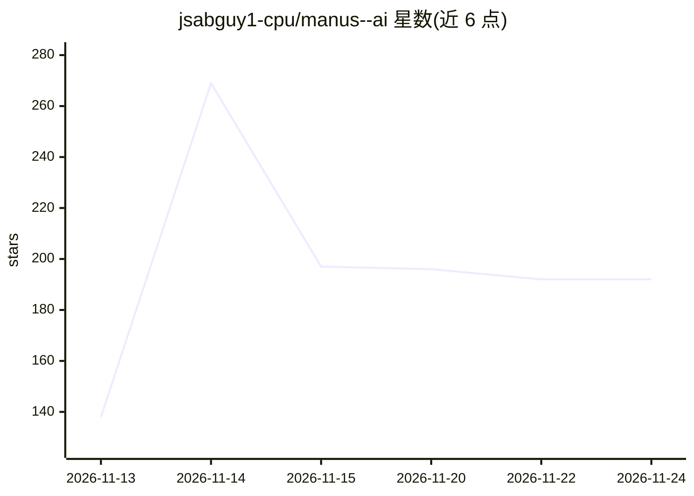

# jsabguy1-cpu/manus--ai

⭐ 192 · Apache-2.0 · 推送 2026-11-19 · [GitHub](https://github.com/jsabguy1-cpu/manus--ai) · 个人维护

**面向个人用户的自主 AI Agent，代用户执行代码与浏览器操作**

README 介绍 Manus 为一个自主 AI Agent：可自行编写并执行脚本、控制浏览器导航网页/填写表单/收集信息，将用户指令拆解为多步骤任务并在后台持续运行。定位为面向家庭、学习与轻度办公场景的个人助手，强调无需编程背景即可使用，并支持跨会话记忆工作模式。README 仅给出最低硬件配置表（双核 CPU、4 GB 内存）与通用启动步骤，未包含下载链接、安装命令或源码获取方式。

## 筛选速览

| 维度 | 判定 | 备注 |
|---|---|---|
| AI 角色 | `ai-native` | 本体是模型或模型工具 |
| 许可风险 | `permissive` | Apache-2.0 |
| 部署形态 | `None` |  |
| 模型依赖 | — | README 未给出锁定关系 |
| 硬件要求 | — | 无带数字的原话,不猜 |
| 安装摩擦 | `low` | 无编译、无系统依赖或容器化 |
| 成熟度 | — | 结构信号不足 |

## 能力要点

- 自主代码执行：agent 自行运行脚本完成任务
- 浏览器控制：导航网页、填写表单、收集信息
- 多步骤自主任务与后台个人助手模式
- 跨会话记忆同一工作流模式

## 适用场景

- 让 agent 代我整理研究资料和运行小脚本
- 自动从多个网页页面收集信息
- 把重复性的填表、查网页等小事交给后台助手

## 场景标签

`AI 助手` `浏览器自动化` · 领域:效率与自动化

## 证据(README 行号)

> L18: Manus is an autonomous AI agent designed to run code and control a browser on your behalf. Instead of acting like a
> L22: Manus is not a heavy studio suite or a complex enterprise platform. It is a focused helper built for home, study, a

## 星数曲线

2026-11-13 138 → 2026-11-24 192（+54）

---
*卡片 v1 · prompt 1.4 · 生成 2026-11-20 · 置信度 mid · 依据 README sha `ca8b3ef518a9` · [字段定义](../../DATASET.md)*
