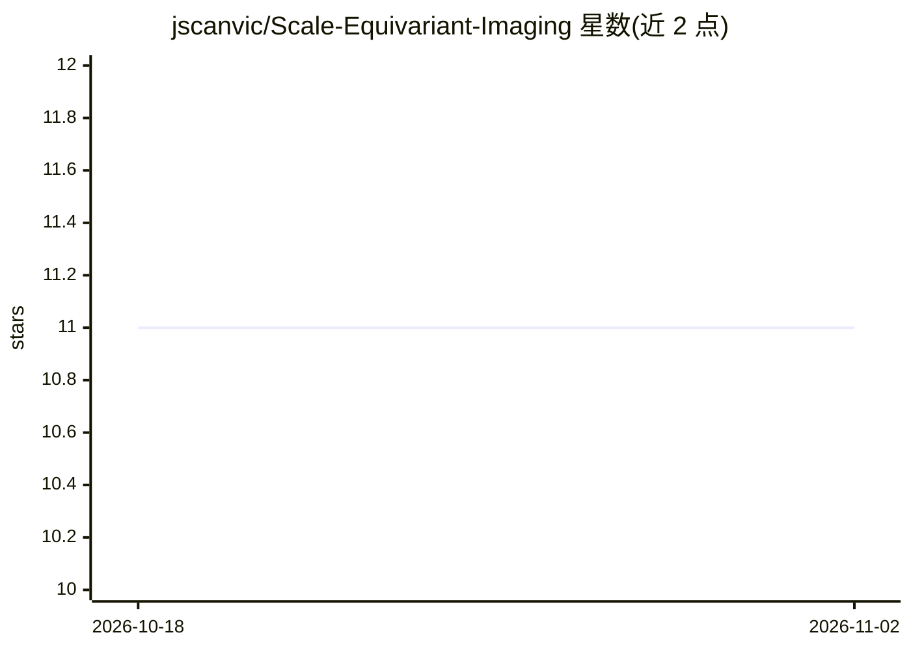

# jscanvic/Scale-Equivariant-Imaging

⭐ 11 · Python · 推送 2026-02-06 · [GitHub](https://github.com/jscanvic/Scale-Equivariant-Imaging) · [官网](https://doi.org/10.1109/TCI.2026.3660011) · 个人维护

**自监督图像超分与去模糊的 PyTorch 官方实现（IEEE TCI 2026）**

论文 Scale-Equivariant Imaging 的官方 PyTorch 代码：利用图像分布的近似尺度不变性，从仅含低频信息的测量数据中自监督学习恢复高频信息，实现图像超分辨率与去模糊，无需 ground truth 数据。提供训练与测试脚本，支持 proposed、supervised、CSS 及 shift/rotate 等变体方法，数据集包括 div2k、urban100、ct；预训练权重托管在 Hugging Face。推荐 Python 3.12.1，通过 git clone 源码加 pip install 依赖运行，设备支持 cpu 或 cuda。

## 筛选速览

| 维度 | 判定 | 备注 |
|---|---|---|
| AI 角色 | `ai-native` | 本体是模型或模型工具 |
| 许可风险 | `none` | — |
| 部署形态 | `library` | 以包/库形式分发 |
| 模型依赖 | — | README 未给出锁定关系 |
| 硬件要求 | — | 无带数字的原话,不猜 |
| 安装摩擦 | `medium` | 含编译或系统依赖之一 |
| 成熟度 | — | 结构信号不足 |

## 能力要点

- 尺度等变成像自监督方法，无需 ground truth 即可做超分与去模糊
- 提供 5 种训练方法变体（proposed/sup/css/ei-shift/ei-rotate）
- 论文预训练权重托管于 Hugging Face，测试输出 PSNR 与 SSIM
- 支持 div2k、urban100、ct 数据集与多种重建算法（swinir/dip/pnp/bm3d 等）

## 适用场景

- 科学/医学成像中缺少真值数据时训练去模糊或超分模型
- 复现论文实验或使用预训练权重做图像重建测试
- 对比自监督与监督方法在图像逆问题上的表现

## 场景标签

`图像视频处理` · 领域:感知与多模态

## 证据(README 行号)

> L1: ## Scale-Equivariant Imaging: Self-Supervised Learning for Image Super-Resolution and Deblurring Official PyTorch im
> L12: Abstract: *Self-supervised methods have recently proved to be nearly as effective as supervised ones in various ima
> L49: python demo/train.py --device cuda:0 \

## 星数曲线

2026-10-18 11 → 2026-11-02 11（+0）

---
*卡片 v1 · prompt 1.4 · 生成 2026-11-02 · 置信度 mid · 依据 README sha `1e08e762719f` · [字段定义](../../DATASET.md)*
