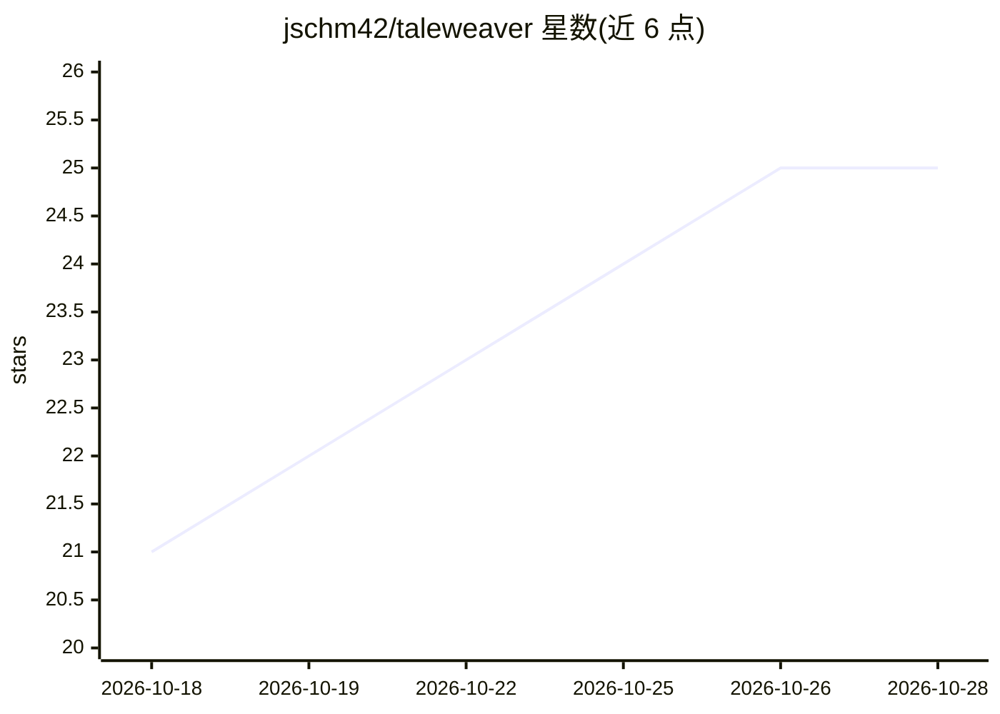

# jschm42/taleweaver

⭐ 25 · Python · MIT · 推送 2026-10-27 · [GitHub](https://github.com/jschm42/taleweaver) · 个人维护

**自托管的生成式 AI 角色扮演文字冒险引擎工作室**

本地优先、可自托管（Docker）的生成式 AI 文字冒险引擎：AI 担任全知游戏主持人，即时生成世界、谜题与剧情，动态扮演 NPC 并维护 RPG 规则。提供可视化冒险编辑器（场景/NPC/物品/任务全 CRUD）、双层 AI 验证、沙盒化 Python 事件脚本引擎、漫画式回合叙事界面、Gemini TTS 与 ElevenLabs 配音、Whisper 语音输入及多语言翻译。BYOK 模式经 LiteLLM 适配器接入云端旗舰模型，实验性支持 Ollama 本地运行；游戏进度存于本地 SQLite，支持检查点回滚。

## 筛选速览

| 维度 | 判定 | 备注 |
|---|---|---|
| AI 角色 | `ai-native` | 本体是模型或模型工具 |
| 许可风险 | `permissive` | MIT |
| 部署形态 | `None` |  |
| 模型依赖 | local-ok | 支持本地模型 |
| 硬件要求 | — | 无带数字的原话,不猜 |
| 安装摩擦 | `low` | 无编译、无系统依赖或容器化 |
| 成熟度 | `idea` | |

## 能力要点

- AI Gamemaster 即时生成世界/谜题/剧情并动态扮演 NPC
- 可视化冒险编辑器：场景、地图路由、NPC、物品、任务全 CRUD
- 沙盒化 Python 事件脚本引擎（隔离 AST 解释器）
- 双层验证（结构图审计 + LLM 剧情批评）与一键 AI 修复建议
- Gemini TTS / ElevenLabs 配音与 Whisper 语音输入

## 适用场景

- 游玩每次都不同的生成式文字冒险
- 自行创作并验证文字冒险模板与事件脚本
- 在自有硬件上部署私密的 AI 跑团/角色扮演工作室

## 场景标签

`AI 写作` · 领域:内容生成

## 证据(README 行号)

> L7: A self-hosted, local-first generative AI roleplaying studio: combining an omniscient AI Gamemaster,
> L37: Instead of a static, predefined story, the AI acts as an intelligent, omniscient Gamemaster (GM). It generates worl
> L82: * **Cloud-Tier Intelligence:** Designed to harness the reasoning power of flagship models (Anthropic Opus 5.x, Open

## 星数曲线

2026-10-18 21 → 2026-10-28 25（+4）

---
*卡片 v1 · prompt 1.4 · 生成 2026-10-27 · 置信度 high · 依据 README sha `6cb2f0bcfcdd` · [字段定义](../../DATASET.md)*
