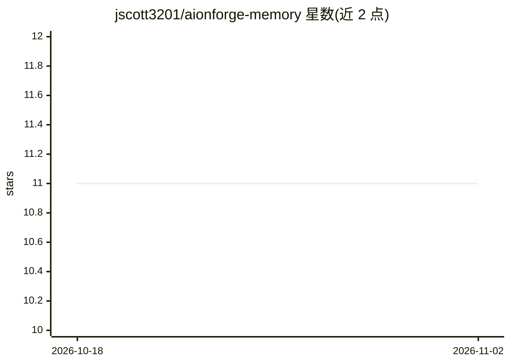

# jscott3201/aionforge-memory

⭐ 11 · Rust · Apache-2.0 · 推送 2026-07-11 · [GitHub](https://github.com/jscott3201/aionforge-memory) · 个人维护

**Rust 编写的 AI agent 长期记忆基座，含 MCP 服务器**

基于 selene-db 图引擎构建的 agent 记忆存储：以不可变 episode 捕获观察与决策，派生事实/实体/笔记，跟踪 work item，提供跨会话混合检索（词法+向量+图+新近度+重要性+信任信号）。全部能力以 MCP 工具/资源/提示暴露，无自带 Web 或终端控制台，另提供 Agent Pager 的 agent 间寻址消息。以单一 Rust 二进制和 crate 库形式提供，支持 Docker 镜像。当前 0.4.0、pre-1.0，schema 与 MCP 表面仍可能变化。

## 筛选速览

| 维度 | 判定 | 备注 |
|---|---|---|
| AI 角色 | `ai-ecosystem` | LLM/agent 周边工具 |
| 许可风险 | `permissive` | Apache-2.0 |
| 部署形态 | `self-host` | docker 或自建部署 |
| 模型依赖 | — | README 未给出锁定关系 |
| 硬件要求 | — | 无带数字的原话,不猜 |
| 安装摩擦 | `low` | 无编译、无系统依赖或容器化 |
| 成熟度 | `idea` | |

## 能力要点

- 不可变 episode 捕获 + 派生事实/实体/笔记的记忆模型
- 词法/向量/图/新近度/重要性/信任的混合检索，返回有界不信任上下文包
- Agent Pager：持久的 agent 间寻址消息（轮询/确认/TTL）
- MCP-only 接口，单一 aionforge 二进制，支持 Docker 与 Rust crate 两种使用方式

## 适用场景

- 让 agent 跨会话记住决策、交接与未完成工作
- 多 agent 团队间传递持久寻址消息
- 为 Codex/Claude Code/Cursor 等客户端接入统一的记忆服务

## 场景标签

`Agent 记忆` `知识图谱` · 领域:Agent 开发

## 证据(README 行号)

> L11: Aionforge Memory gives an agent — or a team of agents — a durable store they can
> L19: It is **MCP-only**: every capability is an MCP tool, resource, or prompt, and there

## 星数曲线

2026-10-18 11 → 2026-11-02 11（+0）

---
*卡片 v1 · prompt 1.4 · 生成 2026-11-02 · 置信度 high · 依据 README sha `d431131ba799` · [字段定义](../../DATASET.md)*
