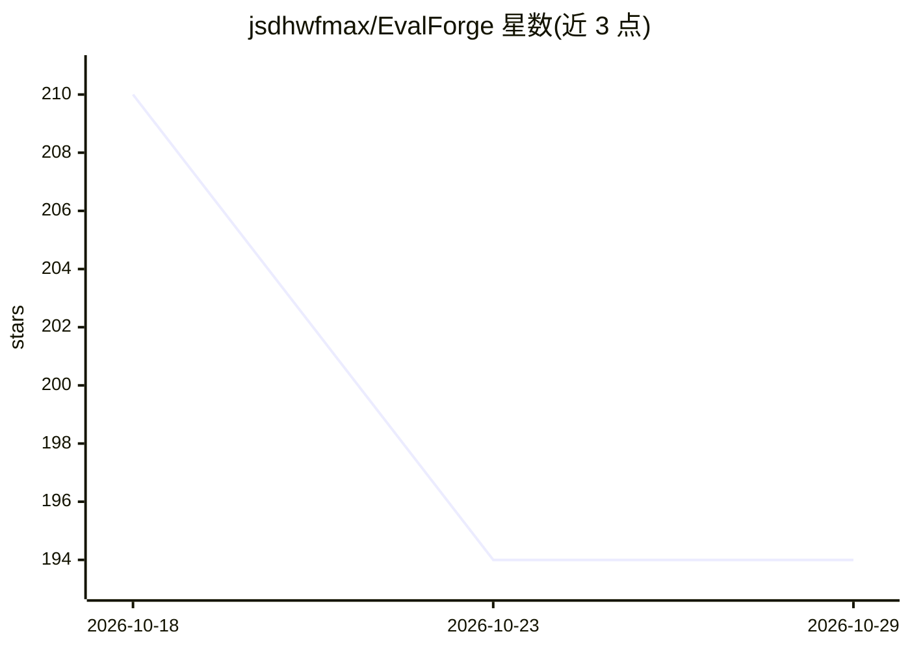

# jsdhwfmax/EvalForge

⭐ 194 · Python · MIT · 推送 2026-10-26 · [GitHub](https://github.com/jsdhwfmax/EvalForge) · 个人维护

**面向 CI 的 RAG/AI 评测证据与质量门禁工具，输出多格式报告**

将 AI 评测结果转化为可审查的发布证据：导入 promptfoo、Ragas、DeepEval 的结果文件（或任意扁平数值摘要），套用带版本的政策门禁（绝对阈值、基线增量、单位/方向契约），在现有 CI 中输出 JSON、JUnit、SARIF 与 Markdown 报告，回归时返回非零退出码。内置离线 RAG 评测器（BM25/向量/混合检索、确定性指标），无需模型 key 或托管账号；gate 仅两个直接依赖。提供 CLI、FastAPI、Streamlit 看板、GitHub Action 与 Docker Compose。v0.6.0 alpha，自述仍在寻求独立验证的下游采用。

## 筛选速览

| 维度 | 判定 | 备注 |
|---|---|---|
| AI 角色 | `ai-ecosystem` | LLM/agent 周边工具 |
| 许可风险 | `permissive` | MIT |
| 部署形态 | `self-host` | docker 或自建部署 |
| 模型依赖 | — | README 未给出锁定关系 |
| 硬件要求 | — | 无带数字的原话,不猜 |
| 安装摩擦 | `low` | 无编译、无系统依赖或容器化 |
| 成熟度 | `idea` | |

## 能力要点

- 导入 promptfoo/Ragas/DeepEval 结果为统一可移植 JSON 工件
- 政策门禁：绝对阈值、基线增量、单位/方向契约、数据集指纹可比性校验
- 输出 JSON/JUnit/SARIF/Markdown 报告，回归时 CI 非零退出
- 内置离线 RAG 评测器，无需模型 key 与托管服务

## 适用场景

- 在 CI 中对 RAG 应用做发布前质量门禁与回归阻断
- 把不同评测框架的结果统一为可比、可审计的发布证据
- 无托管服务地跑基线/候选对比与安全、成本、延迟检查

## 场景标签

`模型评测` `MLOps` · 领域:评测与运维

## 证据(README 行号)

> L12: EvalForge turns AI evaluation results into reviewable release evidence. Import promptfoo, Ragas, or supported DeepE
> L24: EvalForge provides that missing, deliberately narrow interoperability layer. It does not try to replace Ragas, Deep
> L32: 5. Emit a portable artifact plus JSON, JUnit, and SARIF reports; return a non-zero exit code on regression.

## 星数曲线

2026-10-18 210 → 2026-10-29 194（-16）

---
*卡片 v1 · prompt 1.4 · 生成 2026-10-22 · 置信度 high · 依据 README sha `891a1e1345b1` · [字段定义](../../DATASET.md)*
