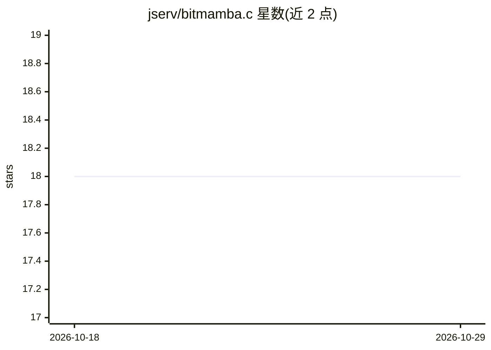

# jserv/bitmamba.c

⭐ 18 · C · MIT · 推送 2026-06-22 · [GitHub](https://github.com/jserv/bitmamba.c) · 个人维护

**面向 BitMamba-2 三值模型的便携 C11 推理引擎**

用 C11 从零实现的推理引擎，运行 BitMamba-2（255M/1B）Mamba-2 状态空间模型：权重为 1.58-bit 三值 {-1,0,+1}，逐 4 个打包进字节，将线性投影矩阵乘化为加减法；SSM 递推、卷积与归一化层保持 float32。面向边缘/入门级 CPU 部署场景的开发者，提供 T-MAC 查表内核、AVX2/NEON/Metal 运行时分发、mmap 零拷贝加载、GPT-2 分词器与多轮对话模式。构建需 C 编译器与 POSIX 头文件，make download 拉取权重。MIT 许可。

## 筛选速览

| 维度 | 判定 | 备注 |
|---|---|---|
| AI 角色 | `ai-ecosystem` | LLM/agent 周边工具 |
| 许可风险 | `permissive` | MIT |
| 部署形态 | `None` |  |
| 模型依赖 | — | README 未给出锁定关系 |
| 硬件要求 | — | 无带数字的原话,不猜 |
| 安装摩擦 | `low` | 无编译、无系统依赖或容器化 |
| 成熟度 | — | 结构信号不足 |

## 能力要点

- 三值权重（每参数 2 bit）使 1B 模型权重约 250 MB，峰值内存 621 MB
- 运行时内核分发：scalar / AVX2 / NEON / Apple Metal GPU
- T-MAC 查表内核将三值乘法替换为 L1 cache 部分和查表
- 多轮 chat 模式：SSM 状态固定、无 KV cache、内存不随轮次增长，支持 --state 会话持久化

## 适用场景

- 在无 NPU/GPU 的入门级 CPU（如 i3-12100F）或树莓派 5 上本地运行 1B 语言模型
- 在电池供电与热受限设备上做低能耗文本生成
- 研究与验证三值量化 SSM 模型的推理性能

## 场景标签

`推理引擎` · 领域:训练与推理

## 证据(README 行号)

> L3: Portable C11 inference engine for
> L47: This project provides a from-scratch C11 inference engine with T-MAC
> L53: - C11 with POSIX dependencies (mmap, clock_gettime), no external libraries

## 星数曲线

2026-10-18 18 → 2026-10-29 18（+0）

---
*卡片 v1 · prompt 1.4 · 生成 2026-10-29 · 置信度 high · 依据 README sha `db5e53770262` · [字段定义](../../DATASET.md)*
