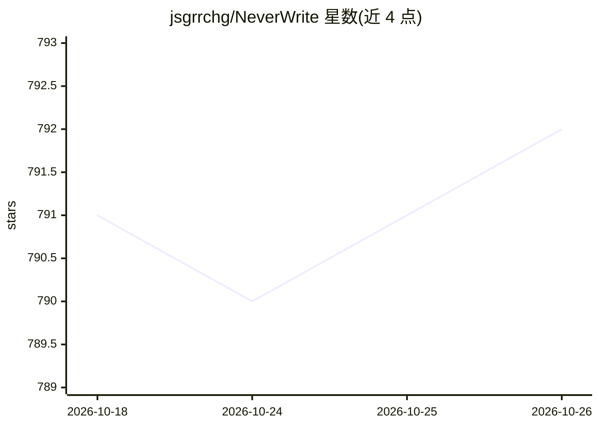

# jsgrrchg/NeverWrite

⭐ 792 · TypeScript · Apache-2.0 · 推送 2026-10-25 · [GitHub](https://github.com/jsgrrchg/NeverWrite) · [官网](https://neverwrite.app/) · 个人维护

**本地优先的 agentic Markdown 工作区：写作+多 Agent+变更审查**

面向在本地 vault 中同时使用多个 AI agent 的用户的桌面多面板应用：集成 Markdown 编辑器（支持 Mermaid/CSV/PDF/Excalidraw）、wikilink/反链/标签与 2D/3D 图谱的知识导航，可运行 Codex、Claude、Grok、Kilo、OpenCode、Pi 等 agent 会话，并提供内联/聊天/审查标签页中对 AI 编辑（文件与 hunk 级）的保留或拒绝流程。附浏览器扩展可将网页剪藏至 vault。桌面发布版支持 macOS 13+/Windows/Linux（x64/ARM64），也可从源码运行（需 Node.js、Rust）。

## 筛选速览

| 维度 | 判定 | 备注 |
|---|---|---|
| AI 角色 | `ai-enhanced` | 去掉 AI 部分产品仍成立 |
| 许可风险 | `permissive` | Apache-2.0 |
| 部署形态 | `library` | 以包/库形式分发 |
| 模型依赖 | — | README 未给出锁定关系 |
| 硬件要求 | — | 无带数字的原话,不猜 |
| 安装摩擦 | `low` | 无编译、无系统依赖或容器化 |
| 成熟度 | — | 结构信号不足 |

## 能力要点

- 同一工作区编辑 Markdown、Mermaid、CSV、PDF、Excalidraw 等格式
- 运行 Codex/Claude/Grok/Kilo/OpenCode/Pi 多种 agent 会话并保留本地历史
- 文件级与 hunk 级的 AI 变更审查（保留/拒绝）
- 配套浏览器扩展剪藏网页内容到 vault

## 适用场景

- 在本地 vault 中写作并让多个 AI agent 参与修改
- 审查并选择保留或拒绝 agent 对文档的每处编辑
- 通过 wikilink、反链和图谱浏览知识网络
- 把网页内容剪藏进本地知识库

## 场景标签

`多智能体` `知识库管理` `AI 写作` · 领域:Agent 开发

## 证据(README 行号)

> L16: NeverWrite is an agentic markdown workspace for people who work with a local vaults and multiple AI agents. It comb
> L22: - **Work with your preferred agent.** Run Codex, Claude, Grok, Kilo, OpenCode, or Pi sessions with attachments, sav

## 星数曲线

2026-10-18 791 → 2026-10-26 792（+1）

---
*卡片 v1 · prompt 1.4 · 生成 2026-10-21 · 置信度 high · 依据 README sha `a7e2bc0afa00` · [字段定义](../../DATASET.md)*
