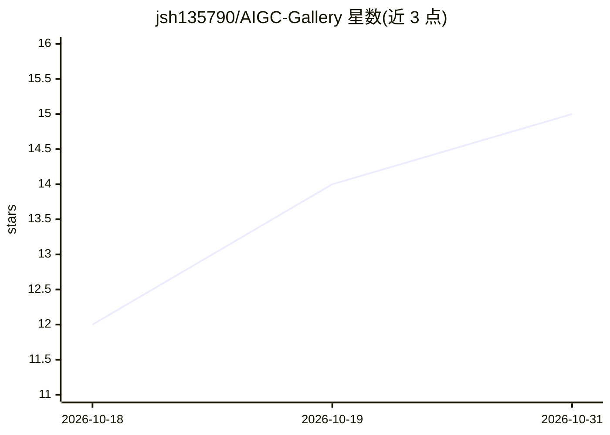

# jsh135790/AIGC-Gallery

⭐ 15 · TypeScript · GPL-3.0 · 推送 2026-10-16 · [GitHub](https://github.com/jsh135790/AIGC-Gallery) · [官网](https://aigc-gallery-three.vercel.app) · 个人维护 · 中文 README

**浏览器本地运行的 AI 图片管理与 PNG 元数据工具**

完全在浏览器中运行的本地 AI 图片管理工具：图库支持批量导入、文件夹/标签筛选与搜索；画师串画廊管理提示词资料；元数据查看器/编辑器读取并编辑 SD WebUI、NovelAI（含 v4 多角色与 Stealth）、ComfyUI 等 PNG 元数据。数据存于浏览器 IndexedDB，无需账号、后端或 API Key，不上传服务器。构建产物为自包含单文件 index.html，可离线使用或部署到静态站点；完整文件夹备份/恢复依赖 Chrome/Edge 的 File System Access API，Firefox/Safari 不提供。

## 筛选速览

| 维度 | 判定 | 备注 |
|---|---|---|
| AI 角色 | `ai-enhanced` | 去掉 AI 部分产品仍成立 |
| 许可风险 | `viral` | GPL-3.0 |
| 部署形态 | `None` |  |
| 模型依赖 | — | README 未给出锁定关系 |
| 硬件要求 | — | 无带数字的原话,不猜 |
| 安装摩擦 | `low` | 无编译、无系统依赖或容器化 |
| 成熟度 | — | 结构信号不足 |

## 能力要点

- 读取与编辑 SD WebUI / NovelAI / ComfyUI PNG 元数据（含 NovelAI Stealth 透明通道隐藏元数据）
- 画师串画廊：分组、示例图、评分、提示词复制与 JSON 导入导出
- 数据全部存本机 IndexedDB，无账号无后端，不上传服务器
- 构建为自包含单文件 index.html，可离线打开或部署到静态托管

## 适用场景

- 本地收藏和整理 AI 生成图片，按标签与文件夹筛选
- 查看和编辑图片中的生成参数与提示词并导出 PNG
- 整理画师串资料并在需要时复制提示词

## 场景标签

 · 领域:AI 图像管理工具

## 证据(README 行号)

> L17: AIGC Gallery 是一款完全在浏览器中运行的本地 AI 图片管理工具，无需账号、后端或 API Key。图片与图库记录保存在当前浏览器的 IndexedDB 中，设置保存在本地；图片导入、元数据解析、编辑和备份均在本机完成
> L27: |元数据编辑器|编辑 SD WebUI / NovelAI PNG 的正负提示词、生成参数和 NovelAI v4 角色提示词，查看改动、逐项撤销、导出 PNG 或回写图库|

## 星数曲线

2026-10-18 12 → 2026-10-31 15（+3）

---
*卡片 v1 · prompt 1.4 · 生成 2026-10-30 · 置信度 high · 依据 README sha `6b80ad4351e0` · [字段定义](../../DATASET.md)*
