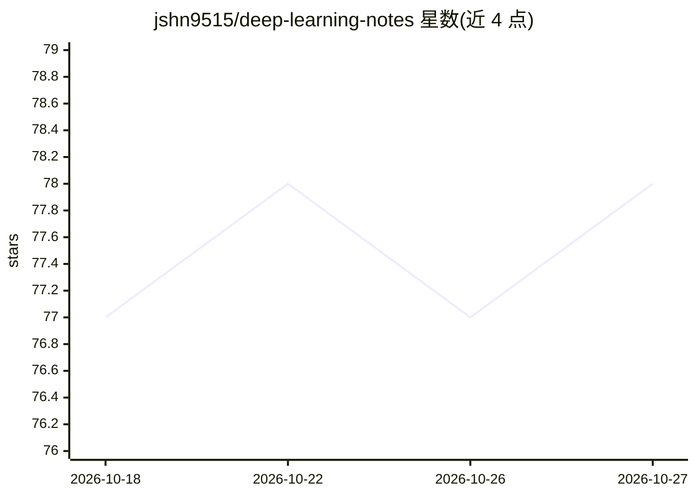

# jshn9515/deep-learning-notes

⭐ 78 · Python · NOASSERTION · 推送 2026-10-26 · [GitHub](https://github.com/jshn9515/deep-learning-notes) · [官网](https://jshn9515.github.io/deep-learning-notes/) · 个人维护 · 中文 README

**个人深度学习学习笔记与教程，覆盖基础到 LLM 推理框架**

以 Quarto Markdown 维护并构建为静态网站的个人深度学习教程笔记，内容从神经网络基础、PyTorch、优化算法、CNN/RNN 讲到 Attention/Transformer、GPT-2 实现、LLM 训练工程、数据处理、scaling laws、评测与 vLLM/SGLang 推理框架。配套 Jupyter Notebook 版本可在 Google Colab 打开，也可用 quarto convert 自行生成。配套 dnnlpy 库（MIT）承载自定义实现，笔记本体采用 CC BY-NC 4.0 许可；作者声明写作过程有 LLM 辅助并经人工修订。

## 筛选速览

| 维度 | 判定 | 备注 |
|---|---|---|
| AI 角色 | `ai-knowledge` | 知识聚合/清单类 |
| 许可风险 | `none` | NOASSERTION |
| 部署形态 | `library` | 以包/库形式分发 |
| 模型依赖 | — | README 未给出锁定关系 |
| 硬件要求 | — | 无带数字的原话,不猜 |
| 安装摩擦 | `low` | 无编译、无系统依赖或容器化 |
| 成熟度 | — | 结构信号不足 |

## 能力要点

- 内容覆盖从神经网络基础到 LLM 训练/推理工程（vLLM、SGLang）
- Quarto Markdown 构建，配套 Jupyter Notebook 可在 Google Colab 打开
- 提供 dnnlpy 辅助库（自定义实现与工具函数）
- 中英双语（English | 简体中文）

## 适用场景

- 自学深度学习时按体系阅读从基础到 LLM 的笔记
- 在 Colab 中直接运行配套 Notebook 做练习
- 参考 GPT-2 从零实现与 LLM 训练/推理工程实践

## 场景标签

`教程课程` · 领域:学习与行业

## 证据(README 行号)

> L17: So I decided to gradually organize what I encounter during my own learning process. These notes start with the basi
> L28: The content mainly includes:

## 星数曲线

2026-10-18 77 → 2026-10-27 78（+1）

---
*卡片 v1 · prompt 1.4 · 生成 2026-10-24 · 置信度 high · 依据 README sha `de5cba87157d` · [字段定义](../../DATASET.md)*
