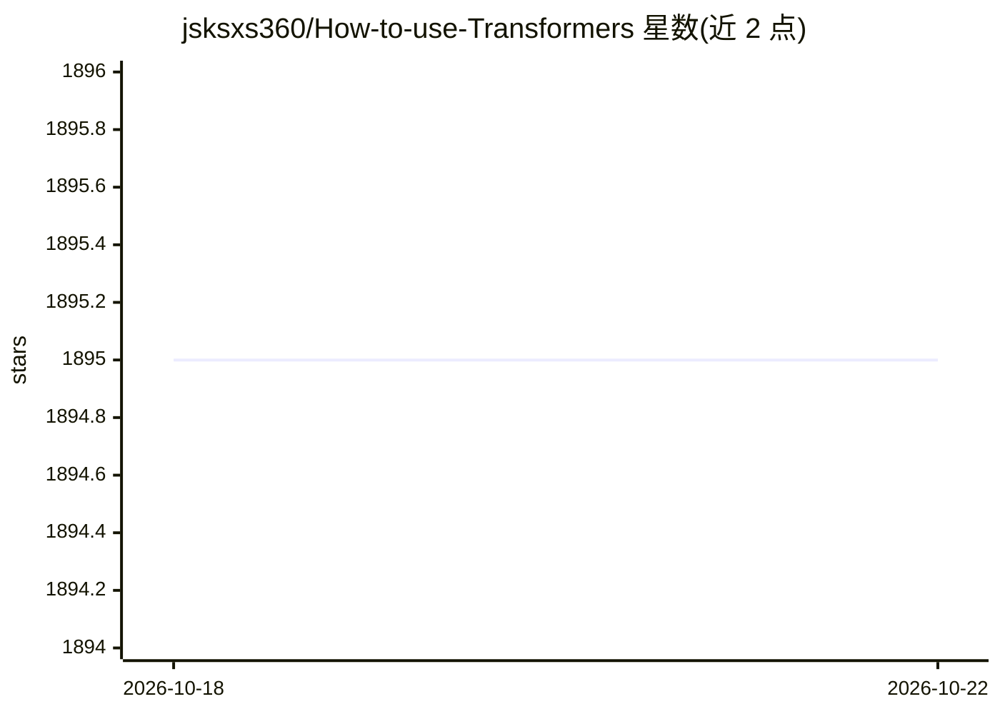

# jsksxs360/How-to-use-Transformers

⭐ 1,895 · Python · Apache-2.0 · 推送 2026-02-24 · [GitHub](https://github.com/jsksxs360/How-to-use-Transformers) · [官网](https://transformers.run/) · 个人维护 · 中文 README

**《Transformers 库快速入门》教程配套代码仓库**

Hugging Face Transformers 库的中文入门教程代码仓库，按 data 与 src 目录组织：src 下每个 NLP 任务一个文件夹，可单独下载使用。内容覆盖 pipelines、模型与分词器、PyTorch 基础、微调预训练模型，以及句子对分类、命名实体识别、中英翻译、文本摘要、抽取式问答、Prompt 情感分析等实战任务；教程处于更新中，正在添加大语言模型章节（含 FlanT5、Llama2 指令微调）。

## 筛选速览

| 维度 | 判定 | 备注 |
|---|---|---|
| AI 角色 | `ai-knowledge` | 知识聚合/清单类 |
| 许可风险 | `permissive` | Apache-2.0 |
| 部署形态 | `None` |  |
| 模型依赖 | — | README 未给出锁定关系 |
| 硬件要求 | — | 无带数字的原话,不猜 |
| 安装摩擦 | `low` | 无编译、无系统依赖或容器化 |
| 成熟度 | — | 结构信号不足 |

## 能力要点

- 按任务组织的示例代码，每个任务文件夹可单独使用
- 覆盖分类、NER、翻译、摘要、抽取式问答、Prompt 情感分析
- 第四部分大语言模型章节（FlanT5/Llama2 指令微调）更新中

## 适用场景

- 系统学习 Transformers 库的基础与实战任务
- 下载对应任务的示例代码作为起步模板
- 了解预训练模型微调与指令微调的代码写法

## 场景标签

`教程课程` · 领域:学习与行业

## 证据(README 行号)

> L5: 该项目为《Transformers 库快速入门》教程的代码仓库，按照以下方式组织代码：
> L8: - *src*：存储示例代码，每个任务对应一个文件夹，可以下载下来单独使用。

## 星数曲线

2026-10-18 1,895 → 2026-10-22 1,895（+0）

---
*卡片 v1 · prompt 1.4 · 生成 2026-10-21 · 置信度 high · 依据 README sha `9873a2bc6659` · [字段定义](../../DATASET.md)*
