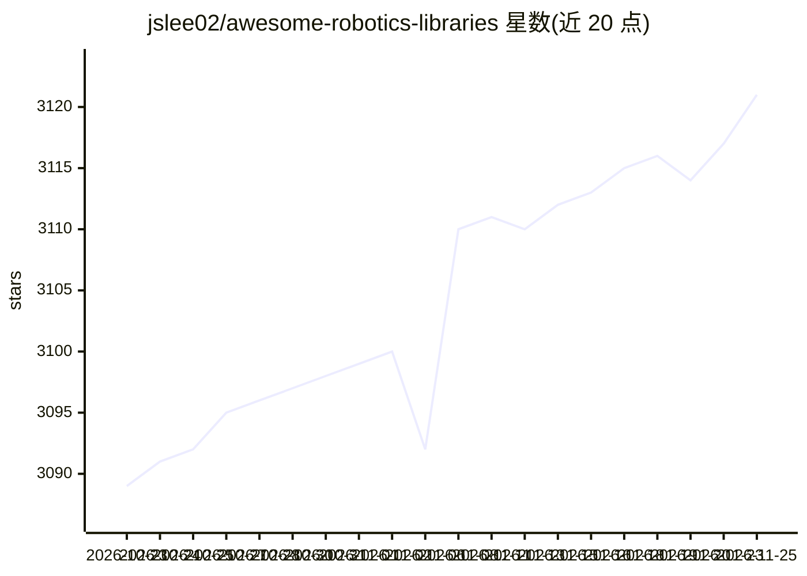

# jslee02/awesome-robotics-libraries

⭐ 3,121 · Python · CC0-1.0 · 推送 2026-11-23 · [GitHub](https://github.com/jslee02/awesome-robotics-libraries) · [官网](http://jslee02.github.io/awesome-robotics-libraries/) · 个人维护

**机器人学开源库与模拟器策展清单**

按类别组织的机器人学开源资源目录，收录中间件与框架（ROS 2、YARP 等）、硬件与驱动、机器人描述格式、运动学与动力学库、物理引擎、模拟器、运动规划与导航等板块，条目附一句话描述、星标数与活跃状态标注（🟢/🟡/💀），并单独列出商业软件小节。供寻找机器人开发工具的开发者与科研人员按类别检索。

## 筛选速览

| 维度 | 判定 | 备注 |
|---|---|---|
| AI 角色 | `ai-knowledge` | 知识聚合/清单类 |
| 许可风险 | `viral` | CC0-1.0 |
| 部署形态 | `None` |  |
| 模型依赖 | — | README 未给出锁定关系 |
| 硬件要求 | — | 无带数字的原话,不猜 |
| 安装摩擦 | `medium` | 含编译或系统依赖之一 |
| 成熟度 | — | 结构信号不足 |

## 能力要点

- 按 Middleware/Hardware/Dynamics/Physics/Simulators/Planning 等类别组织的条目结构
- 条目带活跃度标注（活跃/不活跃/已归档）与星标数
- 含商业模拟与离线编程软件的 Commercial 小节

## 适用场景

- 为机器人项目查找合适的物理引擎或运动学库
- 选型机器人模拟器时浏览开源选项
- 了解机器人学各子领域的开源生态覆盖

## 场景标签

`精选清单` · 领域:学习与行业

## 证据(README 行号)

> L5: A curated list of robotics libraries and simulators.
> L7: ## Contents

## 星数曲线

2026-10-23 3,089 → 2026-11-25 3,121（+32）

---
*卡片 v1 · prompt 1.4 · 生成 2026-11-23 · 置信度 high · 依据 README sha `80b45ce32be5` · [字段定义](../../DATASET.md)*
