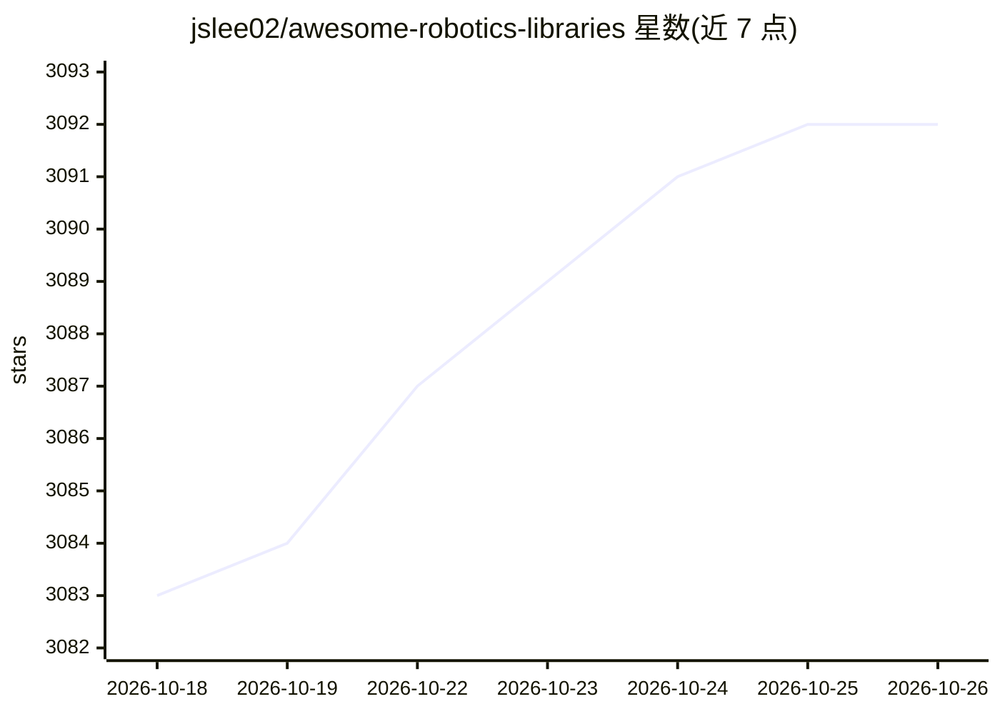

# jslee02/awesome-robotics-libraries

⭐ 3,092 · Python · CC0-1.0 · 推送 2026-10-19 · [GitHub](https://github.com/jslee02/awesome-robotics-libraries) · [官网](http://jslee02.github.io/awesome-robotics-libraries/) · 个人维护

**机器人学库与仿真器策展清单，供机器人开发者选型查阅**

维护中的机器人学软件资源汇总清单：按中间件与框架、硬件驱动、机器人描述格式、运动学与动力学、物理引擎、仿真器（含商业软件分类）、运动规划与导航、控制等类别组织条目。每条给出简介与星标数，并以绿/黄/骷髅图标与'Inactive'分节标注维护状态（无提交3年以上或已归档），另含商业软件子清单。面向机器人开发与研究人员，无安装内容，纯浏览型目录。

## 筛选速览

| 维度 | 判定 | 备注 |
|---|---|---|
| AI 角色 | `ai-knowledge` | 知识聚合/清单类 |
| 许可风险 | `viral` | CC0-1.0 |
| 部署形态 | `None` |  |
| 模型依赖 | — | README 未给出锁定关系 |
| 硬件要求 | — | 无带数字的原话,不猜 |
| 安装摩擦 | `medium` | 含编译或系统依赖之一 |
| 成熟度 | — | 结构信号不足 |

## 能力要点

- 按中间件、动力学、物理引擎、仿真器、规划等类别组织
- 以图标与 Inactive 分节标注条目维护状态
- 收录星标数与简介，含商业软件子分类

## 适用场景

- 为机器人项目查找物理引擎或仿真器
- 比较运动学/动力学库的维护活跃度
- 了解机器人学开源软件生态覆盖范围

## 场景标签

`精选清单` · 领域:学习与行业

## 证据(README 行号)

> L1: # Awesome Robotics Libraries
> L5: A curated list of robotics libraries and simulators.

## 星数曲线

2026-10-18 3,083 → 2026-10-26 3,092（+9）

---
*卡片 v1 · prompt 1.4 · 生成 2026-10-20 · 置信度 high · 依据 README sha `45a040cff543` · [字段定义](../../DATASET.md)*
