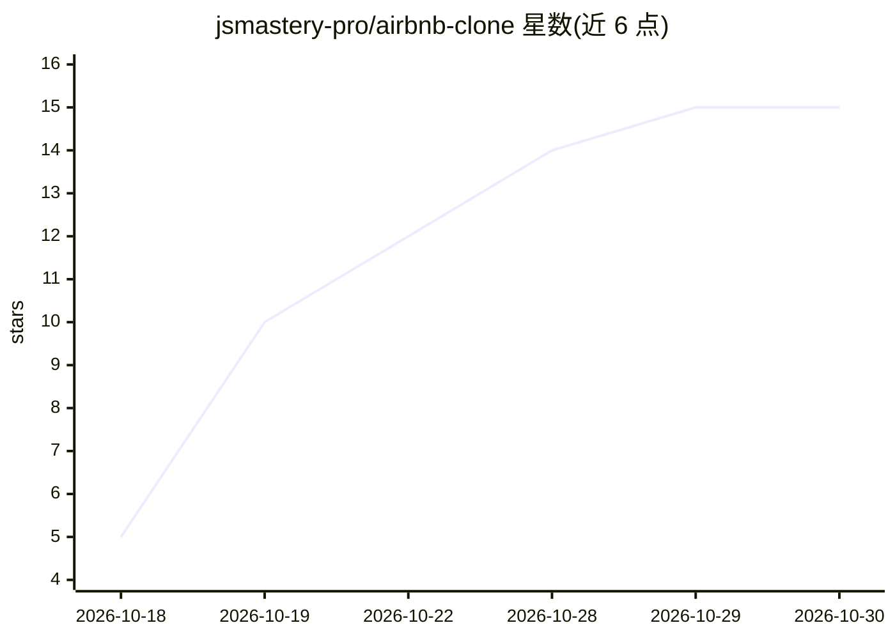

# jsmastery-pro/airbnb-clone

⭐ 15 · TypeScript · MIT · 推送 2026-10-16 · [GitHub](https://github.com/jsmastery-pro/airbnb-clone) · 组织维护

**AI 自然语言搜索的 Airbnb 风格移动应用（教程项目）**

JavaScript Mastery 出品的教程配套代码：用 React Native/Expo 构建的 iOS 与 Android 房源预订应用。用户以英文描述理想住宿（如允许带狗、带热水浴缸、低于某价格），自然语言搜索返回匹配房源；每个房源有基于自身政策文档的问答聊天，回答有出处。技术栈含 Clerk 认证、Sanity 内容与向量嵌入、PostHog 分析。需自行配置各家服务凭证后通过 npx expo start 运行。

## 筛选速览

| 维度 | 判定 | 备注 |
|---|---|---|
| AI 角色 | `ai-native` | 本体是模型或模型工具 |
| 许可风险 | `permissive` | MIT |
| 部署形态 | `library` | 以包/库形式分发 |
| 模型依赖 | — | README 未给出锁定关系 |
| 硬件要求 | — | 无带数字的原话,不猜 |
| 安装摩擦 | `low` | 无编译、无系统依赖或容器化 |
| 成熟度 | — | 结构信号不足 |

## 能力要点

- 英文自然语言描述即可搜索房源，无需筛选器
- 基于单个房源政策内容的 grounded 问答聊天
- Clerk 认证、Sanity 嵌入与知识库、PostHog 行为分析
- 配套 YouTube 分步教程与 agentic engineering 工作流讲解

## 适用场景

- 跟随教程学习 React Native 与 AI 功能集成的移动应用开发
- 参考自然语言搜索与基于文档的聊天实现方式
- 了解如何用 coding agent 分功能构建完整应用

## 场景标签

`语义搜索` `教程课程` `文档问答` · 领域:知识与检索

## 证据(README 行号)

> L26: Roam is a complete Airbnb-style mobile app for iOS and Android where guests skip the filters and dropdowns entirely
> L28: Beyond the app itself, the project teaches a structured agentic engineering workflow: turning an idea into a build 

## 星数曲线

2026-10-18 5 → 2026-10-30 15（+10）

---
*卡片 v1 · prompt 1.4 · 生成 2026-10-30 · 置信度 high · 依据 README sha `e549fabc9961` · [字段定义](../../DATASET.md)*
