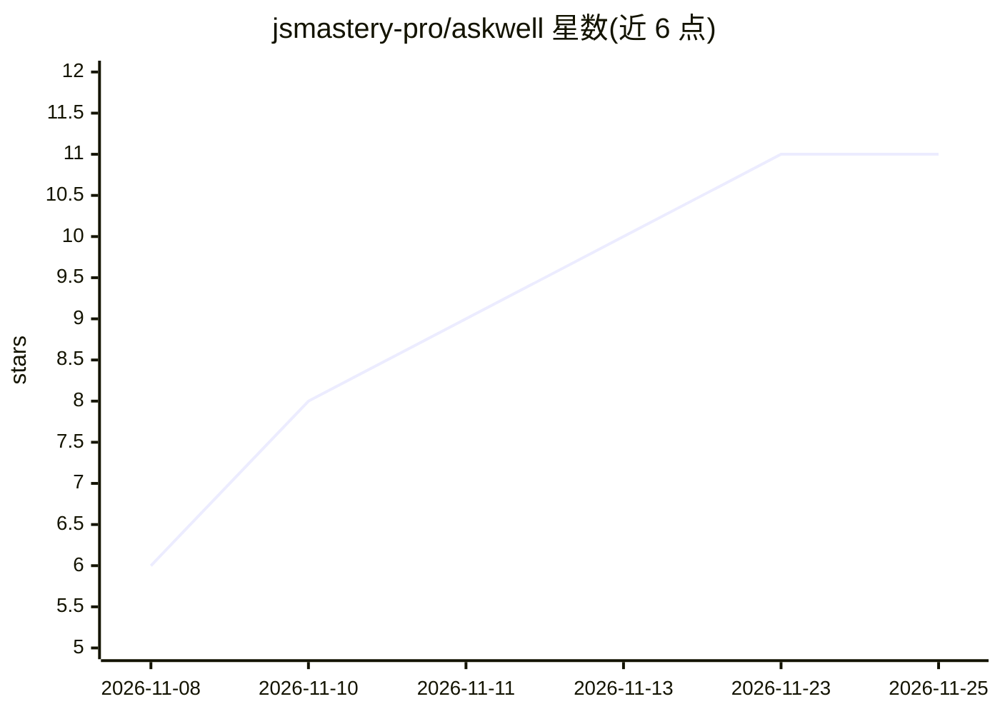

# jsmastery-pro/askwell

⭐ 11 · TypeScript · 推送 2026-11-06 · [GitHub](https://github.com/jsmastery-pro/askwell) · [官网](https://askwell-rho.vercel.app) · 组织维护

**把业务文档变成网站可嵌入 AI 客服机器人的 SaaS 教程项目**

AskWell 是一个配套 JavaScript Mastery YouTube 教程的 SaaS 项目代码：商家注册后上传产品指南、定价页、FAQ 等文档，粘贴一行 script 标签即可在网站嵌入聊天气泡，机器人仅依据上传文档回答，文档中没有的内容会如实说明。内置聊天端点的限流与机器人防护、逐条回答的成本追踪、对话仪表盘；Pro 付费计划解锁挂件样式定制与去徽章。技术栈为 Supabase、Clerk、Arcjet、PostHog、Vercel。

## 筛选速览

| 维度 | 判定 | 备注 |
|---|---|---|
| AI 角色 | `ai-native` | 本体是模型或模型工具 |
| 许可风险 | `none` | — |
| 部署形态 | `library` | 以包/库形式分发 |
| 模型依赖 | — | README 未给出锁定关系 |
| 硬件要求 | — | 无带数字的原话,不猜 |
| 安装摩擦 | `low` | 无编译、无系统依赖或容器化 |
| 成熟度 | — | 结构信号不足 |

## 能力要点

- 基于上传文档的受限回答（grounded answers），文档外内容明确告知不知
- 一行 script 标签嵌入网站聊天挂件
- 聊天端点限流/机器人防护与逐条回答成本追踪
- Pro 计划计费与挂件实时定制

## 适用场景

- 为自己的网站嵌入基于产品文档的访客问答机器人
- 学习从零构建带认证、计费与防护的 SaaS 项目
- 追踪每个 AI 回答的成本与使用分析

## 场景标签

`聊天机器人` `教程课程` · 领域:对话与助手

## 证据(README 行号)

> L26: AskWell is a SaaS that gives any business an AI chatbot for its website. A business signs up, creates a project, an
> L54: 👉 **Grounded AI Answers**: The chatbot answers visitors only from the uploaded docs and says it doesn't know when t

## 星数曲线

2026-11-08 6 → 2026-11-25 11（+5）

---
*卡片 v1 · prompt 1.4 · 生成 2026-11-19 · 置信度 high · 依据 README sha `df9a8d16e410` · [字段定义](../../DATASET.md)*
