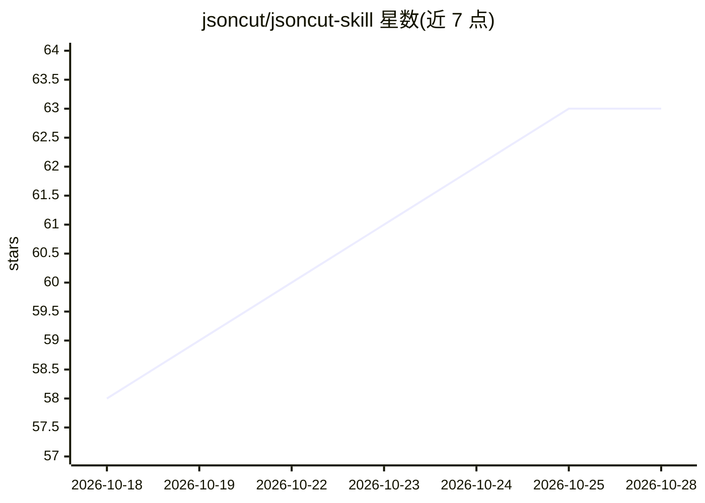

# jsoncut/jsoncut-skill

⭐ 63 · 推送 2026-04-10 · [GitHub](https://github.com/jsoncut/jsoncut-skill) · 组织维护

**教 AI agent 调用 JsonCut API 生成图片和视频的技能文档包**

一组结构化文档（AGENTS.md 及 docs/ 目录），教 Claude Code、Codex、OpenClaw、Cursor、Windsurf 等 AI agent 如何调用 JsonCut 的 REST API，以 JSON 配置、HTML/CSS 图层方式程序化生成图片与视频。覆盖 API 参考、图片生成（6 种图层）、视频生成（16+ 种图层、65+ 转场）、HTML 图层渲染与示例。以放入工作区或引用 AGENTS.md 的方式使用，MIT 许可。

## 筛选速览

| 维度 | 判定 | 备注 |
|---|---|---|
| AI 角色 | `ai-ecosystem` | LLM/agent 周边工具 |
| 许可风险 | `none` | — |
| 部署形态 | `None` |  |
| 模型依赖 | — | README 未给出锁定关系 |
| 硬件要求 | — | 无带数字的原话,不猜 |
| 安装摩擦 | `low` | 无编译、无系统依赖或容器化 |
| 成熟度 | — | 结构信号不足 |

## 能力要点

- 以 AGENTS.md 为入口的结构化 agent 技能文档
- 覆盖图片生成、视频生成、HTML 图层与 API 参考
- 65+ 转场、16+ 视频图层类型的 API 用法文档

## 适用场景

- 让 Claude Code/Codex/Cursor 等 agent 通过 API 自动生成图片和视频
- 在自动化工作流中程序化创建媒体内容

## 场景标签

`图像生成` `视频生成` · 领域:内容生成

## 证据(README 行号)

> L5:  AI agent skill for seamless integration with JsonCut — automated creation of videos and images via API.
> L16: This repository contains structured documentation files that teach AI agents (Claude Code, Codex, OpenClaw, Cursor,

## 星数曲线

2026-10-18 58 → 2026-10-28 63（+5）

---
*卡片 v1 · prompt 1.4 · 生成 2026-10-24 · 置信度 high · 依据 README sha `b26279c11469` · [字段定义](../../DATASET.md)*
