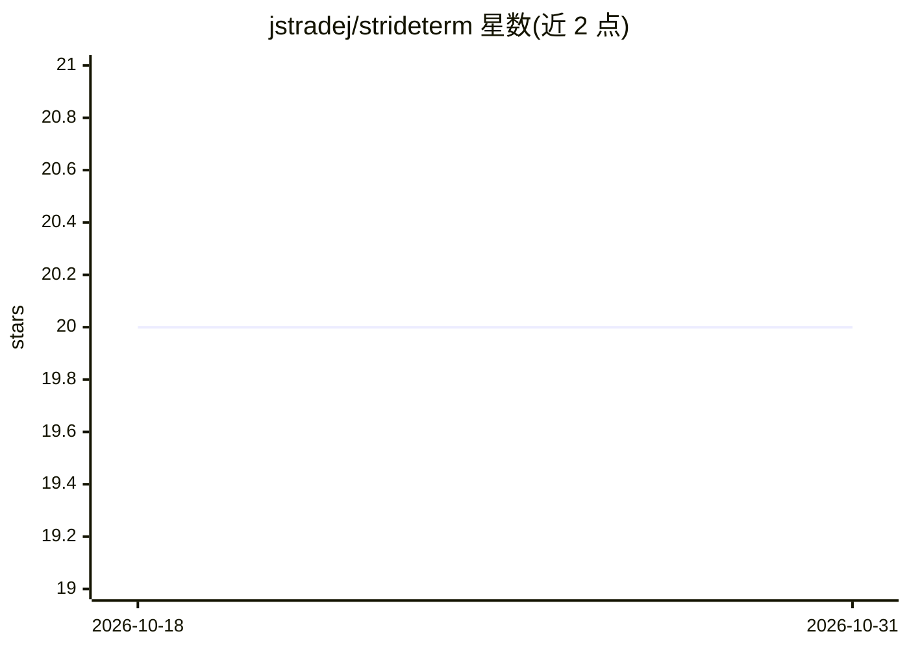

# jstradej/strideterm

⭐ 20 · TypeScript · MIT · 推送 2026-10-30 · [GitHub](https://github.com/jstradej/strideterm) · 个人维护

**把终端、AI 编码代理、Git、Docker 组织进工作区的桌面终端管理器**

面向开发者的桌面终端工作区应用：将 Shell 终端、Claude Code/Codex/Gemini CLI/GitHub Copilot/OpenCode 等 AI 编码代理、GitHub 与 Azure DevOps PR 审查、Git 多仓管理、Docker 容器管理整合到按项目划分的工作区，支持分屏网格、多窗口、SSH、远程访问（LAN/Cloudflare 隧道、手机适配 Web 客户端）、Telegram 机器人控制与命令/代理完成通知（含 Claude Code 可选自动批准并写入 SQLite 审计日志）。本地功能免费，托管移动服务需订阅。提供 Windows/macOS/Linux 预构建安装包，配置存储于 ~/.strideterm/。

## 筛选速览

| 维度 | 判定 | 备注 |
|---|---|---|
| AI 角色 | `ai-enhanced` | 去掉 AI 部分产品仍成立 |
| 许可风险 | `permissive` | MIT |
| 部署形态 | `desktop` | 安装包/桌面程序 |
| 模型依赖 | — | README 未给出锁定关系 |
| 硬件要求 | — | 无带数字的原话,不猜 |
| 安装摩擦 | `low` | 无编译、无系统依赖或容器化 |
| 成熟度 | — | 结构信号不足 |

## 能力要点

- 工作区组织终端标签、AI 编码代理、Git、Docker 与文件管理
- Agent Task Runner 用 Worker/Judge 代理监督编码任务
- 远程访问：LAN/Cloudflare 隧道 + 手机适配 Web 客户端，会话可撤销
- 完成通知区分提问与空闲等待；Claude Code 可选自动批准带 SQLite 审计记录

## 适用场景

- 把多个项目的终端、AI 代理和 Git 工作集中到一个应用管理
- 在手机上通过远程访问查看和操控本地工作区
- 让代理跑任务时收到完成或提问通知，不必盯屏幕

## 场景标签

 · 领域:开发者工具/终端

## 证据(README 行号)

> L3: **strIDEterm** organizes your shells, AI coding agents, code reviews, Docker, and Git into workspaces you can access
> L10: - **Tab Templates** - quickly add Shell, Claude Code, Codex, Gemini CLI, GitHub Copilot, OpenCode, Dev Server, File

## 星数曲线

2026-10-18 20 → 2026-10-31 20（+0）

---
*卡片 v1 · prompt 1.4 · 生成 2026-10-28 · 置信度 high · 依据 README sha `fedce104c98d` · [字段定义](../../DATASET.md)*
