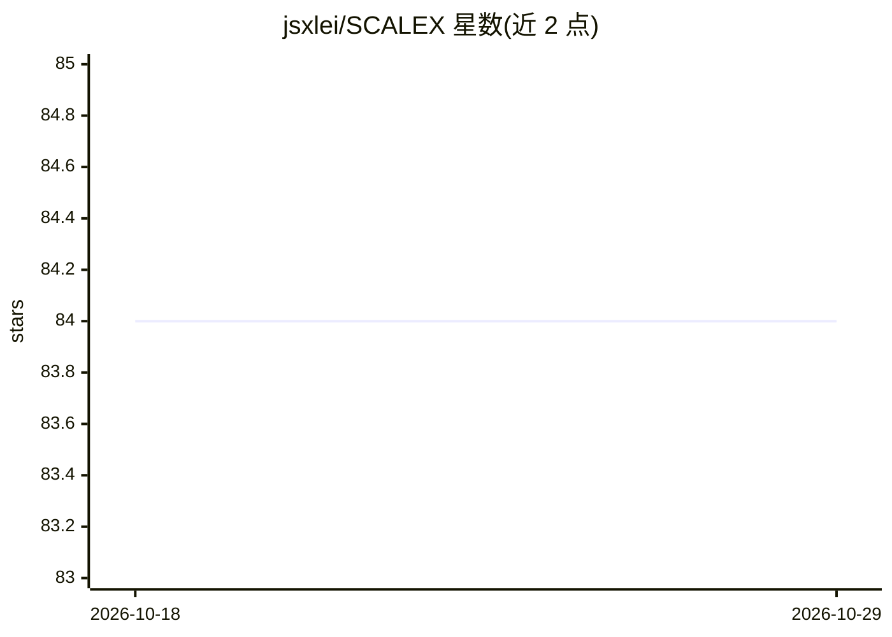

# jsxlei/SCALEX

⭐ 84 · Jupyter Notebook · BSD-3-Clause · 推送 2026-06-25 · [GitHub](https://github.com/jsxlei/SCALEX) · 个人维护

**将异源单细胞数据投影到共同细胞嵌入空间的在线整合工具**

基于 PyTorch 实现的单细胞数据整合方法：将异质数据集投影到共同的细胞嵌入空间（cell-embedding space），支持 scRNA-seq 与 scATAC-seq（--profile ATAC）两类数据，可在线投影新数据集（--projection）、同时做填补（--impute）、聚类与 UMAP 可视化。提供命令行与 Jupyter Notebook API 两种使用方式，输入兼容 txt/csv/h5ad/h5mu/mtx 等格式，输出 AnnData 对象可与 scanpy 衔接，可运行于 CPU，有 GPU 时推荐使用 GPU。通过 PyPI 提供 pip 安装。

## 筛选速览

| 维度 | 判定 | 备注 |
|---|---|---|
| AI 角色 | `ai-native` | 本体是模型或模型工具 |
| 许可风险 | `permissive` | BSD-3-Clause |
| 部署形态 | `library` | 以包/库形式分发 |
| 模型依赖 | — | README 未给出锁定关系 |
| 硬件要求 | — | 无带数字的原话,不猜 |
| 安装摩擦 | `low` | 无编译、无系统依赖或容器化 |
| 成熟度 | — | 结构信号不足 |

## 能力要点

- 异源单细胞数据集在线整合到共同细胞嵌入空间
- 支持 RNA 与 ATAC 两类单细胞谱（--profile）
- 命令行与 Jupyter API 双入口，输出 AnnData 可接 scanpy
- 支持新数据投影、基因表达填补与 UMAP/聚类输出

## 适用场景

- 整合多个批次或来源的单细胞转录组/ATAC 数据
- 将新数据集投影到已训练模型的嵌入空间
- 获得潜在表示、聚类与 UMAP 可视化用于后续分析

## 场景标签

 · 领域:生物信息学/单细胞基因组学

## 证据(README 行号)

> L6: # Online single-cell data integration through projecting heterogeneous datasets into a common cell-embedding space
> L28: SCALEX is implemented in Pytorch framework.

## 星数曲线

2026-10-18 84 → 2026-10-29 84（+0）

---
*卡片 v1 · prompt 1.4 · 生成 2026-10-24 · 置信度 high · 依据 README sha `ccd311af1cca` · [字段定义](../../DATASET.md)*
