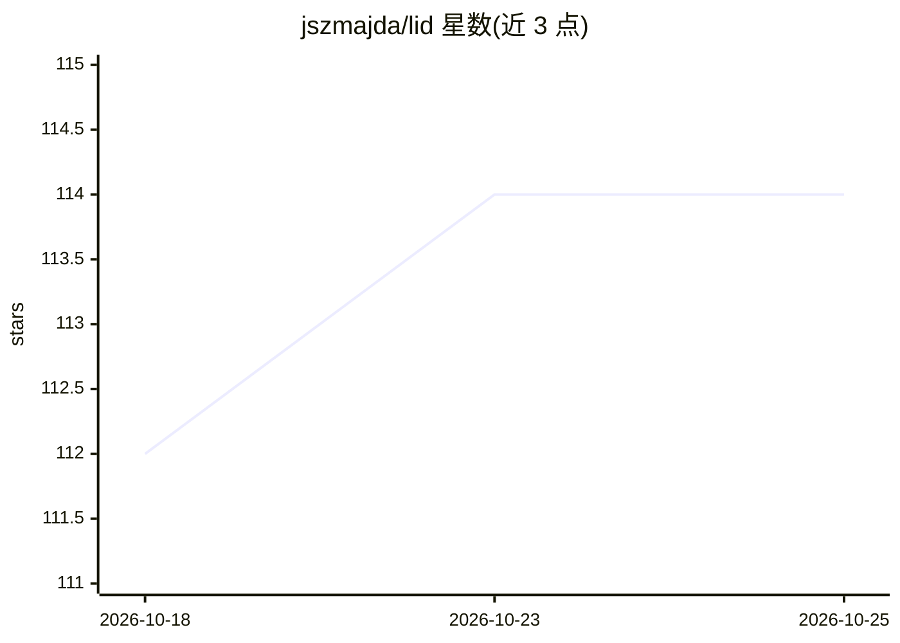

# jszmajda/lid

⭐ 114 · Python · MIT · 推送 2026-10-24 · [GitHub](https://github.com/jszmajda/lid) · [官网](https://linked-intent.dev) · 个人维护

**面向 agentic coding 的先设计后编码方法论与 Claude Code 插件**

Linked-Intent Development（LID）是一套规范驱动开发（SDD）方法论：通过 HLD→LLD→EARS→测试→代码的意图链条，把设计文档作为项目事实源，代码视为可再生的输出产物。以两个 Claude Code 核心插件（linked-intent-dev 工作流、arrow-maintenance 一致性追踪）加一个实验插件形式提供，也支持 Cursor、Copilot、Aider 等工具通过规则文件接入。要求使用者遵守设计评审纪律，实验技能目前仅限 Claude Code。

## 筛选速览

| 维度 | 判定 | 备注 |
|---|---|---|
| AI 角色 | `ai-ecosystem` | LLM/agent 周边工具 |
| 许可风险 | `permissive` | MIT |
| 部署形态 | `None` |  |
| 模型依赖 | — | README 未给出锁定关系 |
| 硬件要求 | — | 无带数字的原话,不猜 |
| 安装摩擦 | `low` | 无编译、无系统依赖或容器化 |
| 成熟度 | — | 结构信号不足 |

## 能力要点

- HLD→LLD→EARS→Tests→Code 意图链，变更自上而下传播
- 两个核心 Claude Code 插件 + 实验插件 bidirectional-differential
- EARS 规格带语义 ID，测试以 @spec 注解溯源
- 通过 AGENTS.md 规则文件适配 Cursor/Copilot 等其他编码工具

## 适用场景

- 在 AI 编码代理动手前先对齐设计意图
- 大项目中追踪规格与代码的一致性
- 让代码可从设计文档再生、跨会话保留上下文

## 场景标签

`编码 Agent` · 领域:编码与开发

## 证据(README 行号)

> L10: A structured design-before-code methodology for agentic coding. Stop building the wrong thing — get alignment on *w
> L83: **Two core Claude Code plugins** for linked-intent development, plus rule-file adapters for other agentic coding to

## 星数曲线

2026-10-18 112 → 2026-10-25 114（+2）

---
*卡片 v1 · prompt 1.4 · 生成 2026-10-23 · 置信度 high · 依据 README sha `6eebbca3f7b3` · [字段定义](../../DATASET.md)*
