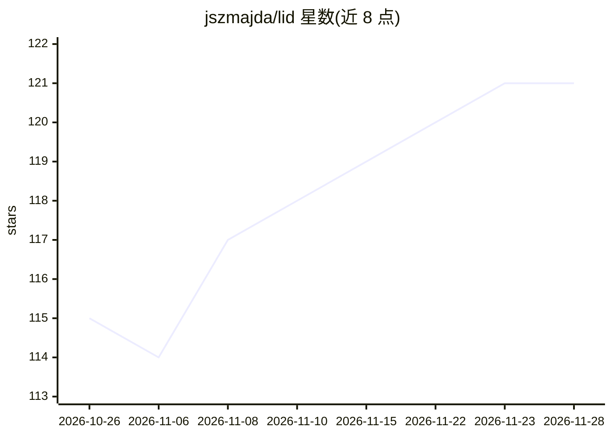

# jszmajda/lid

⭐ 121 · HTML · MIT · 推送 2026-11-27 · [GitHub](https://github.com/jszmajda/lid) · [官网](https://linked-intent.dev) · 个人维护

**面向 agentic coding 的规格驱动开发方法论与 Claude Code 插件**

提供一套先设计后编码的 SDD 方法论：以 HLD → LLD → EARS 规格 → 测试 → 代码的意图链组织文档，规格作为项目的事实来源，代码被视为可再生的输出；变更只沿链条向下游传播。以两个核心 Claude Code 插件（linked-intent-dev、arrow-maintenance）和一个实验性插件交付，内含阶段评审门与 EARS↔代码一致性审计技能；其他 agentic 编码工具通过指向 AGENTS.md 的规则文件采用同一工作流。README 强调方法论本身需要使用者执行设计评审的纪律。

## 筛选速览

| 维度 | 判定 | 备注 |
|---|---|---|
| AI 角色 | `ai-ecosystem` | LLM/agent 周边工具 |
| 许可风险 | `permissive` | MIT |
| 部署形态 | `None` |  |
| 模型依赖 | — | README 未给出锁定关系 |
| 硬件要求 | — | 无带数字的原话,不猜 |
| 安装摩擦 | `low` | 无编译、无系统依赖或容器化 |
| 成熟度 | — | 结构信号不足 |

## 能力要点

- HLD→LLD→EARS→测试→代码的意图链，规格为事实来源
- 两个核心 Claude Code 插件加一个可选实验插件
- 提供 Cursor/Windsurf/Copilot/Aider 等工具的规则文件适配
- 实验性技能以双向重构方式审计 EARS↔代码一致性

## 适用场景

- 在 agentic 编码前对齐设计意图，减少规格与代码的偏差
- 大型项目通过 docs/arrows/ 索引追踪规格与代码的一致性
- 让多个 agentic 编码工具遵循同一套项目内工作流

## 场景标签

`编码 Agent` `代码审查` · 领域:编码与开发

## 证据(README 行号)

> L10: A structured design-before-code methodology for agentic coding. Stop building the wrong thing — get alignment on *w
> L83: **Two core Claude Code plugins** for linked-intent development, plus rule-file adapters for other agentic coding to

## 星数曲线

2026-10-26 115 → 2026-11-28 121（+6）

---
*卡片 v1 · prompt 1.4 · 生成 2026-11-28 · 置信度 high · 依据 README sha `e9c326a2c989` · [字段定义](../../DATASET.md)*
