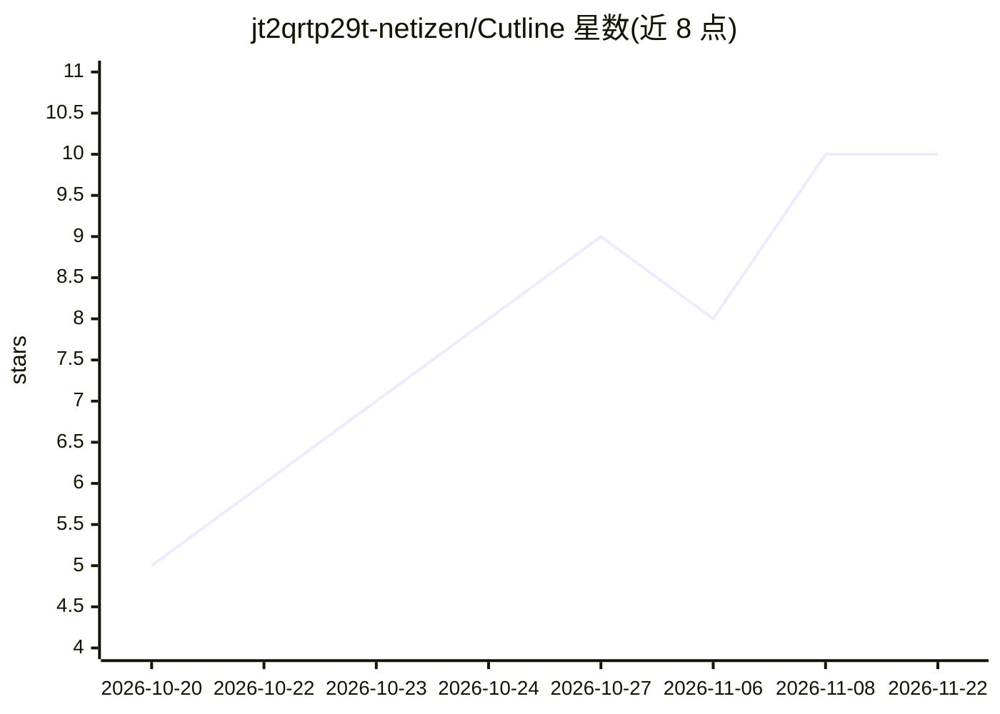

# jt2qrtp29t-netizen/Cutline

⭐ 10 · Swift · GPL-3.0 · 推送 2026-10-18 · [GitHub](https://github.com/jt2qrtp29t-netizen/Cutline) · 个人维护

**macOS 原生多轨视频剪辑器，含本地转录与 AI 缩略图**

以 Swift/SwiftUI 编写、无第三方依赖的 macOS 原生非线性视频编辑器，按 8 个标签页组织：多轨时间线剪辑、关键帧动效、调色（轮盘/曲线/LUT/示波器）、音频混音与闪避、基于 Apple Speech 框架的本地转录与 .srt 字幕、Manim 动画（模板或 Python 脚本）、沙盒试剪，以及 H.264/HEVC/ProRes 导出。安装需 dmg 安装包（Apple silicon 需 macOS 27，Sequoia 分支支持 macOS 15），或用 Xcode 从源码构建；Manim 与 Ollama 为可选工具。

## 筛选速览

| 维度 | 判定 | 备注 |
|---|---|---|
| AI 角色 | `ai-enhanced` | 去掉 AI 部分产品仍成立 |
| 许可风险 | `viral` | GPL-3.0 |
| 部署形态 | `desktop` | 安装包/桌面程序 |
| 模型依赖 | local-ok | 支持本地模型 |
| 硬件要求 | — | 无带数字的原话,不猜 |
| 安装摩擦 | `high` | 编译与系统依赖俱全 |
| 成熟度 | — | 结构信号不足 |

## 能力要点

- 多轨时间线剪辑与关键帧动画、调色、混音一站式覆盖
- 本地转录字幕：Apple Speech 框架，词级时间与 .srt 导出
- Manim 动画模板与自定义 Python 脚本透明渲染
- Make Thumbnail 用 Apple Vision 与可选 Ollama 本地模型选帧，数据不出本机

## 适用场景

- 在 Apple silicon Mac 上做多轨剪辑与调色
- 为视频生成并烧录本地转录字幕
- 用 Manim 模板制作片头字幕条与计分动画

## 场景标签

`图像视频处理` `语音识别` · 领域:感知与多模态

## 证据(README 行号)

> L3: A native video editor for macOS, written in Swift and SwiftUI with no third-party dependencies.
> L23: - **Captions**: on-device transcription (Apple's Speech framework) with word timing, editable transcripts, styled b
> L26: - **Export**: H.264, HEVC and ProRes 422 exports, plus **Make Thumbnail**, which picks the best frames with Apple's

## 星数曲线

2026-10-20 5 → 2026-11-22 10（+5）

---
*卡片 v1 · prompt 1.4 · 生成 2026-11-19 · 置信度 mid · 依据 README sha `941eefbc1111` · [字段定义](../../DATASET.md)*
