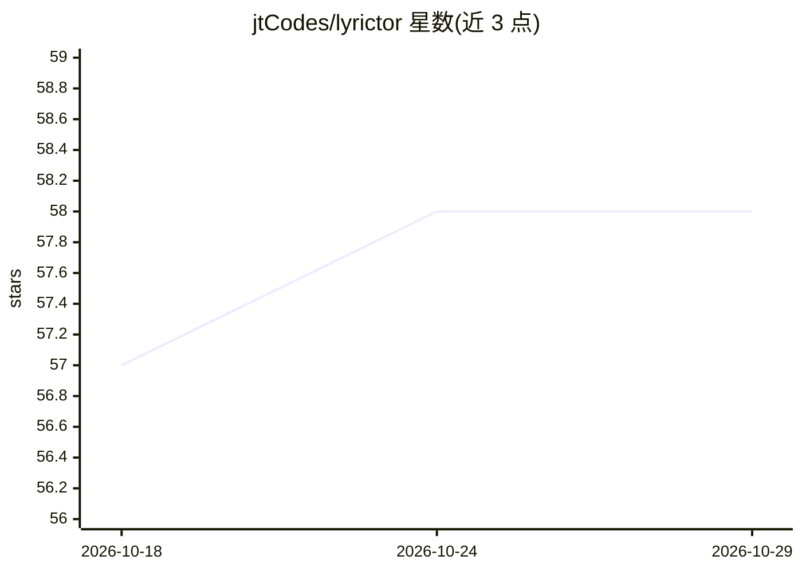

# jtCodes/lyrictor

⭐ 58 · TypeScript · GPL-3.0 · 推送 2026-09-09 · [GitHub](https://github.com/jtCodes/lyrictor) · [官网](https://lyrictor.com) · 个人维护

**把歌曲个人诠释做成可视化作品的创作工具**

桌面（Electron）与浏览器双形态的创意工具：导入歌曲（支持 YouTube URL），在磁贴式时间线上做歌词同步排版（自由布局或 Apple Music 式竖屏滚动）、音频驱动的可视化块，并可发布与导出横竖屏视频。内置 AI 图像生成功能：通过 OpenRouter 图像模型（含 Gemini、GPT 图像模型）或可选的本地 Stable Diffusion，从提示词生成背景与场景图。使用需 Node.js 20.19+/22.12+ 与 Yarn 4 本地开发；macOS 桌面版未公证。

## 筛选速览

| 维度 | 判定 | 备注 |
|---|---|---|
| AI 角色 | `ai-enhanced` | 去掉 AI 部分产品仍成立 |
| 许可风险 | `viral` | GPL-3.0 |
| 部署形态 | `None` |  |
| 模型依赖 | locked-api |  |
| 硬件要求 | — | 无带数字的原话,不猜 |
| 安装摩擦 | `low` | 无编译、无系统依赖或容器化 |
| 成熟度 | — | 结构信号不足 |

## 能力要点

- 波形时间线上的歌词同步与分层时间线条目
- 内置 AI 图像生成（OpenRouter 图像模型，可选本地 Stable Diffusion）
- 音频实时驱动的可视化块
- 浏览器内横竖屏视频导出与项目版本管理

## 适用场景

- 为喜欢的歌曲制作可分享的歌词视觉作品
- 在时间线上编排歌曲情绪起伏对应的画面
- 用 AI 生成背景图并叠入歌词动画后导出视频

## 场景标签

`图像生成` · 领域:内容生成

## 证据(README 行号)

> L3: Lyrictor is a desktop and browser-based creative tool for turning personal interpretations of songs, including songs
> L15: - AI image generation directly inside the creative flow

## 星数曲线

2026-10-18 57 → 2026-10-29 58（+1）

---
*卡片 v1 · prompt 1.4 · 生成 2026-10-24 · 置信度 high · 依据 README sha `0667a94ff3f8` · [字段定义](../../DATASET.md)*
