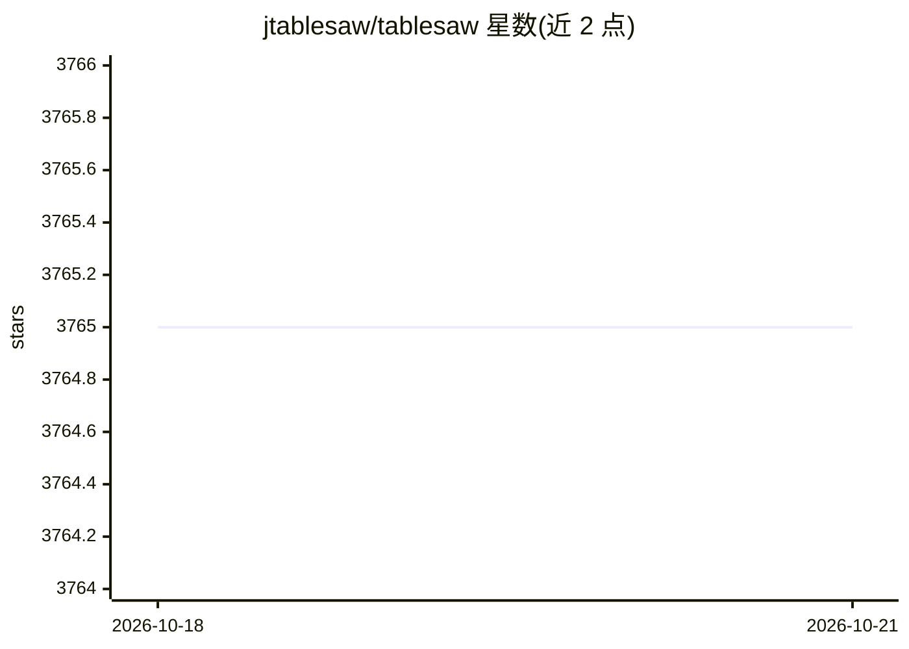

# jtablesaw/tablesaw

⭐ 3,765 · Java · Apache-2.0 · 推送 2026-08-08 · [GitHub](https://github.com/jtablesaw/tablesaw) · [官网](https://jtablesaw.github.io/tablesaw/) · 组织维护

**Java 数据处理与可视化库：加载、清洗、变换、汇总数据**

面向 Java 开发者的 dataframe 与可视化库：支持从 RDBMS、Excel、CSV、JSON、HTML、固定宽度文本及 http/S3 远程源导入数据，提供合并、连接、排序、分组、过滤、转置、Map/Reduce、缺失值处理等变换操作，以及描述性统计；可视化通过封装 Plot.ly JavaScript 库实现。定位之一是为 Smile、Tribuo、H2O.ai、DL4J 等机器学习库准备数据。以 Maven 依赖形式分发，另有 Excel、JSON、HTML、jsplot 等配套子项目。

## 筛选速览

| 维度 | 判定 | 备注 |
|---|---|---|
| AI 角色 | `ai-ecosystem` | LLM/agent 周边工具 |
| 许可风险 | `permissive` | Apache-2.0 |
| 部署形态 | `None` |  |
| 模型依赖 | — | README 未给出锁定关系 |
| 硬件要求 | — | 无带数字的原话,不猜 |
| 安装摩擦 | `low` | 无编译、无系统依赖或容器化 |
| 成熟度 | — | 结构信号不足 |

## 能力要点

- 多格式数据导入（RDBMS/Excel/CSV/JSON/HTML/固定宽度，含 http/S3 远程）
- 排序、分组、连接、转置、Map/Reduce、缺失值处理等变换能力
- 描述性统计（均值、方差、百分位、偏度、峰度等）
- 封装 Plot.ly 的图表能力与 Jupyter/BeakerX 集成

## 适用场景

- 在 Java 中完成数据加载、清洗与变换流水线
- 为 Smile、Tribuo、DL4J 等机器学习库准备输入数据
- 在 Jupyter（BeakerX/IJava/Colab）中交互式探索数据并绘图

## 场景标签

 · 领域:数据处理/数据科学

## 证据(README 行号)

> L9: __Tablesaw__ is a dataframe and visualization library that supports loading, cleaning, transforming, filtering, and 
> L80: * You may utilize Tablesaw with many machine learning libraries. To see an example of using Tablesaw with Smile che

## 星数曲线

2026-10-18 3,765 → 2026-10-21 3,765（+0）

---
*卡片 v1 · prompt 1.4 · 生成 2026-10-20 · 置信度 high · 依据 README sha `c44c0e8f3207` · [字段定义](../../DATASET.md)*
