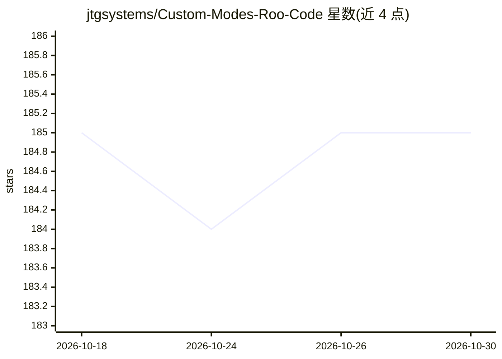

# jtgsystems/Custom-Modes-Roo-Code

⭐ 185 · Python · MIT · 推送 2026-09-03 · [GitHub](https://github.com/jtgsystems/Custom-Modes-Roo-Code) · [官网](https://jtgsystems.com) · 组织维护

**面向 Roo Code 的 225 个 AI agent 配置库，10 类职业角色**

为 VS Code 的 Roo Code 扩展（含 Antigravity IDE）提供 YAML 格式的自定义模式配置集合：共 225 个 agent，按 AI/ML、核心开发、DevOps、语言专家、法律合规、元编排、安全质量等 10 类组织，另含 11 个 SOTA 2026 推理 persona。通过 git clone 或选择性复制到 ~/.roo-code/agents/ 安装，附 Python 脚本做 YAML 校验、批量更新与格式转换。前提是已安装 Roo Code 扩展；Python 3.13+ 仅为脚本所需。

## 筛选速览

| 维度 | 判定 | 备注 |
|---|---|---|
| AI 角色 | `ai-knowledge` | 知识聚合/清单类 |
| 许可风险 | `permissive` | MIT |
| 部署形态 | `None` |  |
| 模型依赖 | — | README 未给出锁定关系 |
| 硬件要求 | — | 无带数字的原话,不猜 |
| 安装摩擦 | `medium` | 含编译或系统依赖之一 |
| 成熟度 | — | 结构信号不足 |

## 能力要点

- 225 个 YAML agent 配置，覆盖 10 个类别
- 11 个 SOTA 2026 推理 persona（分层级体系）
- 提供校验/更新/格式转换三个 Python 脚本
- MIT 许可，支持选择性按类别安装

## 适用场景

- 为 Roo Code 挑选特定领域的 AI agent 配置
- 按类别组合 agent 搭建开发工作流
- 参考 YAML 结构编写自己的自定义模式

## 场景标签

`编码 Agent` `提示工程` · 领域:Agent 开发

## 证据(README 行号)

> L13: > **Professional AI Agent Configuration Library for Roo Code — 2026 Edition**
> L42: - ✅ **225 Specialized Agents** across 10 categories
> L231: Each agent YAML file can be used directly with Roo Code's custom mode system:

## 星数曲线

2026-10-18 185 → 2026-10-30 185（+0）

---
*卡片 v1 · prompt 1.4 · 生成 2026-10-22 · 置信度 high · 依据 README sha `06499ebbbcfc` · [字段定义](../../DATASET.md)*
