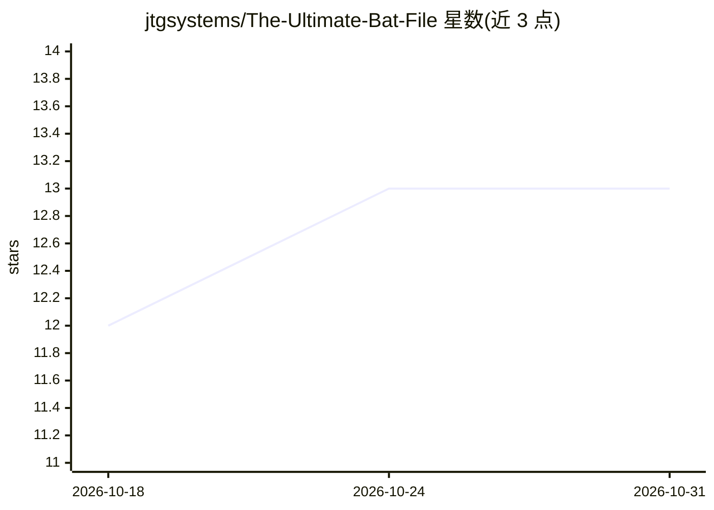

# jtgsystems/The-Ultimate-Bat-File

⭐ 13 · Batchfile · 推送 2026-09-03 · [GitHub](https://github.com/jtgsystems/The-Ultimate-Bat-File) · [官网](https://jtgsystems.com) · 组织维护

**Windows 系统管理批处理脚本合集（200+ 工具，菜单式）**

由 JTG Systems 的 John Gallie 维护的 Windows 系统管理批处理/PowerShell 脚本套件：以 20 项主菜单组织 200+ 工具，覆盖系统信息查询（18 项）、维护清理（20+ 项）、安全中心（Defender/防火墙/BitLocker）、网络、存储与性能监控。要求管理员权限运行，注册表修改前自动备份并可创建还原点。需 Windows 10/11 或 Server 2019/2022，PowerShell 5.1 或 7.0+。README 中无 AI 功能描述，主题标签中的 ai/llm/rag 在正文中未对应任何功能。

## 筛选速览

| 维度 | 判定 | 备注 |
|---|---|---|
| AI 角色 | `ai-enhanced` | 去掉 AI 部分产品仍成立 |
| 许可风险 | `permissive` | — |
| 部署形态 | `None` |  |
| 模型依赖 | — | README 未给出锁定关系 |
| 硬件要求 | — | 无带数字的原话,不猜 |
| 安装摩擦 | `low` | 无编译、无系统依赖或容器化 |
| 成熟度 | — | 结构信号不足 |

## 能力要点

- 200+ Windows 工具按 20 项主菜单分类组织
- 注册表操作前自动备份，支持系统还原点创建
- 服务优化分 Safe/Balanced/Performance 三档
- 会话日志记录（logs/ultimate-tools-YYYYMMDD.log）

## 适用场景

- 一站式查看 CPU/内存/存储/BIOS 等系统信息
- 执行磁盘清理、碎片整理、WinSxS 清理等维护任务
- 管理 Windows Defender、防火墙与 BitLocker 设置

## 场景标签

 · 领域:Windows 系统管理工具

## 证据(README 行号)

> L276: *Enterprise Systems Architecture, Custom Workstations & AI Solutions*

## 星数曲线

2026-10-18 12 → 2026-10-31 13（+1）

---
*卡片 v1 · prompt 1.4 · 生成 2026-10-31 · 置信度 low · 依据 README sha `e00f87994015` · [字段定义](../../DATASET.md)*
