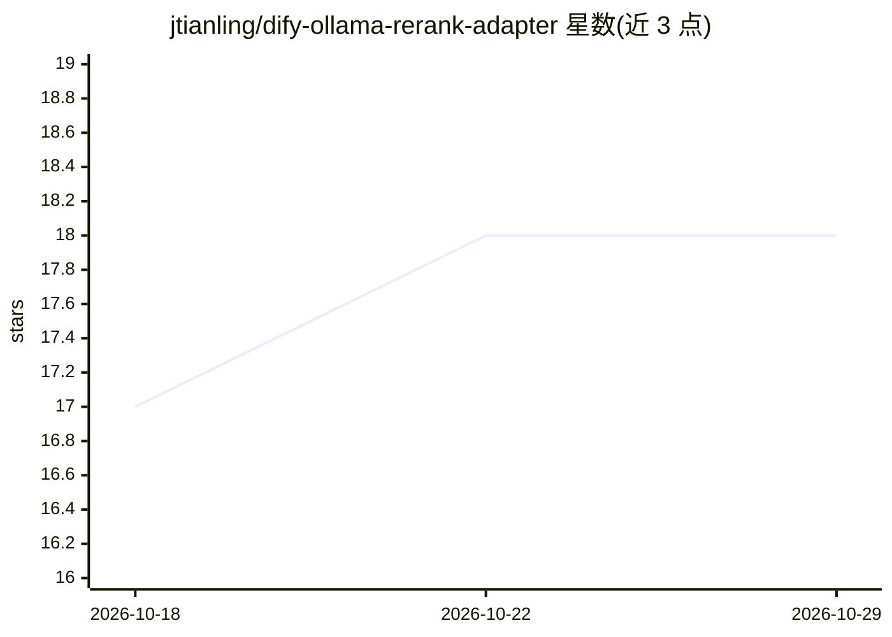

# jtianling/dify-ollama-rerank-adapter

⭐ 18 · JavaScript · MIT · 推送 2025-12-09 · [GitHub](https://github.com/jtianling/dify-ollama-rerank-adapter) · 个人维护 · 中文 README

**把 Ollama 本地 Rerank 模型封装成标准 Rerank API 供 Dify 调用的适配服务**

基于 Node.js/Express 的轻量 HTTP 服务，采用适配器模式：接收 Dify 发出的 Rerank 请求，提取文档文本后调用本地 Ollama 的 Rerank 模型（默认 dengcao/Qwen3-Reranker-8B:Q5_K_M）对文档与查询做相关性打分，按分数降序返回标准格式结果。面向希望用免费本地模型替代联网付费 Rerank 服务（如 Cohere、Jina）的 Dify 用户。需 Node.js 18+ 与本地运行中的 Ollama，端口、模型、Ollama 地址均通过环境变量配置，支持 Docker 环境下 Dify 的接入（host.docker.internal 或 172.17.0.1）。

## 筛选速览

| 维度 | 判定 | 备注 |
|---|---|---|
| AI 角色 | `ai-ecosystem` | LLM/agent 周边工具 |
| 许可风险 | `permissive` | MIT |
| 部署形态 | `library` | 以包/库形式分发 |
| 模型依赖 | local-ok | 支持本地模型 |
| 硬件要求 | — | 无带数字的原话,不猜 |
| 安装摩擦 | `low` | 无编译、无系统依赖或容器化 |
| 成熟度 | — | 结构信号不足 |

## 能力要点

- 适配器模式封装 Ollama Rerank 模型为标准 Rerank API（/api/rerank）
- 完全本地运行，无需联网，兼容 Dify 的 Rerank API 格式
- 通过环境变量配置端口、Ollama 地址与模型，支持切换其他 Rerank 模型
- 支持批量并行文档处理，提供 /health 与 /api/models 端点

## 适用场景

- 让 Dify 知识库检索用本地免费模型做文档重排
- RAG 应用在离线环境下降本，替代付费 Rerank 服务
- 企业内网部署的知识库搜索结果排序

## 场景标签

`RAG` · 领域:知识与检索

## 证据(README 行号)

> L8: A lightweight HTTP service that wraps Ollama's Rerank model into a standard Rerank API, enabling Dify and other appl
> L12: Dify is a powerful LLM application development platform with support for knowledge bases and document retrieval. Wh
> L158: 1. **Receive Request** - Adapter receives Rerank request from Dify

## 星数曲线

2026-10-18 17 → 2026-10-29 18（+1）

---
*卡片 v1 · prompt 1.4 · 生成 2026-10-29 · 置信度 high · 依据 README sha `c03c2aee20cb` · [字段定义](../../DATASET.md)*
